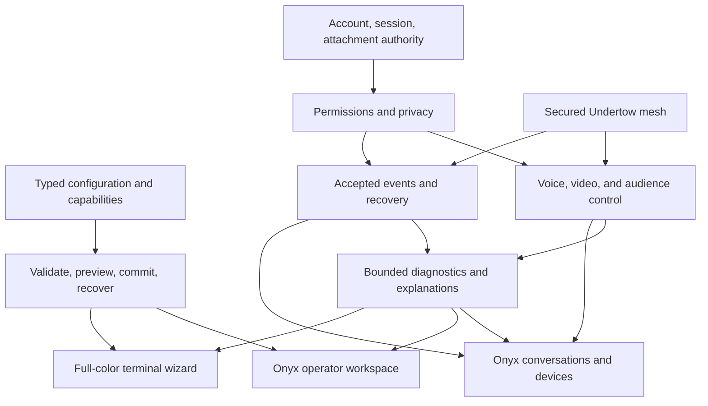

# Onyx integrated delivery roadmap

> **Superseded / historical — preserved as evidence.** This document is a point-in-time record and does not describe the current source or fleet. Current truth: [docs hub](README.md) and [production paths](ops/onyx-server-paths.md). Do not execute it as a current procedure.

2026-10-26 · planning baseline · Onyx Server + Onyx client contracts

**Roadmap specification finalized: 2026-10-29.** All 98 targets below are
assigned exactly once to seven product waves, with dependencies, accountable
owners, client handoffs and acceptance gates. Planning is complete; delivery
is not. The current implementation inventory is **30 accepted, 25 partial,
43 open**, with source/platform qualifications in the
[acceptance ledger](ops/roadmap-acceptance-ledger-2026-10-26.md).

Start with the [seven-wave assignment](#complete-delivery-assignment), the
[accountable owners](#accountable-wave-owners), and the
[Onyx client handoff](design/onyx-client-integration-2026-10-26.md).
The execution history supplies evidence; it does not replace this delivery plan.

The goal is a cohesive system that is easy to set up, pleasant to use, private,
fast, and reliable during failures and upgrades. Integration is the organizing
principle: setup, identity, moderation, sessions, messaging, media, mesh,
diagnostics, and recovery must share authoritative state and explicit contracts.

This is a new execution plan, not a claim that its features have shipped.
Current source and tests override older roadmaps. The source manifest at this
cut is 0.8.1. Cloaking work is being implemented alongside this document;
implementation, review, suite results, reproducible artifacts, and deployment
remain separate acceptance states. No live release is authorized by this plan.

The companion [Onyx client change outline](design/onyx-client-integration-2026-10-26.md)
maps these server capabilities into user journeys. Client source is outside this
repository and has not been audited; that outline describes proposed work.

Implementation has started in [coordinated delivery waves](ops/roadmap-wave-execution-2026-10-26.md).
That execution ledger records bounded accepted slices and outstanding checks;
the tables below remain the full feature acceptance targets.

## Source baseline and integration seams

| Area | Existing foundation | What must be proved before calling a new workflow complete |
| --- | --- | --- |
| Configuration and operations | [main.zig](../src/main.zig), [config_format.zig](../src/daemon/config_format.zig), existing `doctor` and `--check-config` | A wizard plan uses the same parser and validators as startup; diagnostics never start a listener. |
| Identity and privacy | [cloak.zig](../src/proto/cloak.zig), [guise.zig](../src/daemon/guise.zig), [services.zig](../src/daemon/services.zig) | Visibility changes preserve correctly scoped moderation; account and persona ownership cannot collide. |
| Sessions | [sessions.zig](../src/daemon/sessions.zig), [session_replica.zig](../src/daemon/helix/session_replica.zig), [session_reclaim_mesh.zig](../src/proto/session_reclaim_mesh.zig) | One logical session retains independent physical attachments, stable local tokens, and exact delivery through upgrades. |
| Media rooms | [media_cmd.zig](../src/daemon/media_cmd.zig), [media_room.zig](../src/daemon/media_room.zig), [media_plane.zig](../src/daemon/media_plane.zig) | Accepted room state reaches real transports and every eligible participant, including after reconnect. |
| Native/browser media | [media_bridge.zig](../src/daemon/media_bridge.zig), [native_media_transport.zig](../src/daemon/native_media_transport.zig), [sfu_srtp.zig](../src/daemon/sfu_srtp.zig) | Shared codec negotiation and actual encoded-payload interoperability are demonstrated; header rewrapping is not transcoding. |
| Media quality | [media_pacer.zig](../src/substrate/media_pacer.zig), [simulcast_select.zig](../src/substrate/simulcast_select.zig), [cadence_nack.zig](../src/substrate/cadence_nack.zig), [cadence_fec.zig](../src/substrate/cadence_fec.zig) | Controllers work together under measured loss, jitter, congestion, and slow receivers. Helpers alone do not establish call quality. |
| Mesh and routes | [route_table.zig](../src/substrate/undertow/route_table.zig), [mesh.zig](../src/substrate/undertow/mesh.zig), [mesh_presence_retained.zig](../src/daemon/mesh_presence_retained.zig) | Secured multi-hop convergence, deterministic replay, deletion retention, and resource bounds hold under faults. |
| Alpine delivery | [release.sh](../packaging/release.sh), [Dockerfile](../packaging/Dockerfile), musl release target | Native startup, supported CPU baseline, service supervision, recovery, and packaged permissions pass on Alpine. |

Use existing foundations before adding parallel registries, alternate config
parsers, new token types, or another service-control implementation. Existing
uncommitted Helix, module, and WebTransport work must be preserved and assessed
separately. This plan does not reopen previously closed Armor or IRCX cuts.

## Release waves

Versions are assigned after compatibility review. These are dependency waves,
not promised dates or preselected public tags.

| Wave | User-visible result | Exit condition |
| --- | --- | --- |
| R0 — trust and measurement | Cloaks rotate every 14 days by default; compatible rules remain effective; startup refuses requested key failure. | Security regression matrix, migration limitations reported, fresh independent review, full suite with count, critical ReleaseSafe gates. |
| R1 — first successful installation | A full-color wizard produces a validated Alpine or portable installation plan. | Empty-machine install, interrupted resume, upgrade preview, rollback, monochrome/headless equivalence. |
| R2 — dependable everyday use | Session recovery, understandable errors, and moderation previews work across nodes. | Real clients complete all core journeys without a command reference or token copying. |
| R3 — excellent voice | Soundcheck, fast call join, reliable device changes, fair audio under congestion. | Native/browser call matrix, impaired networks, declared recovery boundaries, accessibility and bounded per-participant cost; R6 verifies upgrade continuity for included voice capabilities. |
| R4 — excellent video | Adaptive camera and screen sharing with reliable native/browser coexistence. | Sustained mixed calls, bandwidth transitions, screen readability, keyframe and feedback abuse tests. |
| R5 — resilient larger mesh | Efficient reconciliation and media distribution scale without weakening authority. | Distinct-host non-clique topologies, partitions/rejoin, slow nodes, measured CPU/memory/bandwidth curves. |
| R6 — integrated operation | Operators rehearse changes and upgrades with a clear explanation of impact. | Reproducible signed artifacts, service-manager parity, canary/rollback evidence, client/server compatibility matrix. |

Each wave should contain multiple small, independently reviewable releases.
No media or setup work waits for every later mesh idea. A release includes only
accepted slices and explicitly lists remaining capability gaps.

### Accountable wave owners

These are responsibility roles, not assertions that a client team or deployment
environment has already been assigned. The coordinator names the actual writer
and non-overlapping files before starting each delivery contract.

| Wave | Accountable implementation owner | Required handoff and dependency |
| --- | --- | --- |
| R0 | Identity/session owner; daemon integrator for lifecycle | Fourteen-day cloaks, scoped moderation, credential boundaries and compatibility diagnostics; independent security reviewer challenges the complete identity journey. |
| R1 | Setup/Alpine owner; client maintainer for onboarding | Reuse accepted configuration/identity contracts from R0. Deliver wizard, enrollment, measured capacity and explicit service plans; enrollment and resource enforcement remain distinct unfinished work. |
| R2 | Session/policy owner; client maintainer for recovery | Reuse R0 authority and R1 capability/plan schemas. Deliver independent devices, stable reusable tokens, scoped revocation, understandable errors, permission previews and quiet maintenance. |
| R3 | Voice/media owner; client maintainer for devices | Reuse session and room authority plus transport assessment. Deliver actual soundcheck/calls, device recovery, audience control and scheduling that protects voice and control work. |
| R4 | Video/media owner; client maintainer for capture/layout | Build on R3 transport and congestion contracts. Deliver camera/screen consent, receiver-driven layers, renegotiation, native/browser payload interoperability and endurance. |
| R5 | Mesh owner; session/media owners for their replicated state | Health/reconciliation can advance from R0/R2 contracts in parallel with media work. Media distribution additionally depends on the accepted R3/R4 audience and encryption contracts. |
| R6 | Release gate owner; authorized deploy owner; documentation owner | Gate every proposed release's included features: compatibility, full tests, native Alpine, reproducible artifacts, rolling mesh/client acceptance and rollback. Deployment is a separate authorized action. |

GPT-6.1 Sol at medium reasoning coordinates bounded integration; GPT-6.1 Terra
implements isolated leaves and fixtures; GPT-6 Astra independently challenges
cross-module and security boundaries. The sole daemon writer remains responsible
for `server.zig`. Model assignment never replaces file ownership or fresh review.

### Execution boundary

Run one bounded integration contract and up to two independent leaf contracts.
Each starts with a named outcome, files, dependencies, exact acceptance and a
stop point. Seal the result, review it, run the applicable gates and accept it or
record its concrete blocker. Implementation test failures do not reopen roadmap
planning or hold unrelated waves behind the same investigation.

Lossless, exact-generation QUIT delivery is integrated after 97 Debug and
97 Safe tests and independent review; P01 is accepted. The next integration
contract is the daemon capability/topology snapshot and MESH dispatch. The retained TLS benchmark is repaired and measured against an identified
optimized artifact. Structured service plans and Linux kernel startup capability
checks are integrated and accepted for their recorded scope. Current contracts
close indexed token work and daemon-published mesh status; enrollment and actual
resource enforcement remain separate unfinished work. These are execution steps
under the existing 98 targets, not additional roadmap waves.

Actionable follow-ups must explicitly restart a completed writer. A queued status
message is not a running assignment. Reuse passing evidence only when unchanged
dependencies and current-artifact integration checks prove its applicability;
do not repeat whole campaigns solely because a new investigation was suggested.

## Shared architecture: one fact, several views

1. **One configuration model.** File loading, wizard questions, validation,
   defaults, upgrade comparison, and export consume the same typed schema.
2. **One identity model.** Address, account, logical session, physical
   attachment, persona, and node origin have different authority. UI labels
   never become authorization inputs.
3. **One capability decision per peer or client.** Unsupported features have
   explicit fallback behavior; neither a marketing version nor a successful
   TCP connection establishes support.
4. **One operation plan.** Config changes and upgrades have inspectable input,
   validation, staged work, commit, observations, and rollback boundaries.
5. **One explanation format.** Admission, permission, media, and route decisions
   return bounded, redacted reason codes usable in IRC replies, the wizard,
   diagnostics, and client help. Sensitive policy details remain privileged.
6. **One resource envelope.** Admission limits, history replay, media budgets,
   reconnect work, and mesh repair share measured resource pressure instead of
   independently exhausting the host.
7. **One evidence record.** Feature status carries source revision, commands,
   pass counts, topology, and outstanding risks. A helper test is not a release.

New extensions need a design record with canonical encoding, size limits,
authenticated authority, retry behavior, mixed-capability behavior, persistence,
Helix schema impact, and downgrade rules before implementation.

The proposed integration has shared contracts beneath both interfaces:

## A. Cloaking, privacy, and moderation

| ID | Deliverable | Acceptance |
| --- | --- | --- |
| P01 | Fourteen-day default anonymous rotation, configurable and wall-clock consistent. | Online rotation and offline return behave consistently across nodes; explicit old settings are identified. |
| P02 | Versioned epoch/cadence provenance for public anonymous cloaks. | Historical matching has bounded work, authenticated address inputs, and no real-address disclosure. |
| P03 | Automatic moderation continuity across rotations. | `+b/+e/+I/+Z`, ACCESS, SACCESS, AKICK, and WARD retain original nick/ident/address scope. |
| P04 | Collision-resistant account-cloak encoding with safe compatibility. | Permitted punctuation, long names, case folding, and crafted lookalikes cannot share privileges. |
| P05 | Fail-closed configured key derivation and validated cloak settings. | Primary or previous-key failure does not silently generate a replacement; secrets are never printed. |
| P06 | Uniform direct, trusted-PROXY, IPv4, and mapped-IPv6 identity. | Equivalent addresses have equal policy results, clone counts, and reputation handling. |
| P07 | Privacy preview before applying a persona, login, or network change. | The client explains public visibility and account linkability without displaying moderation internals. |
| P08 | Moderation impact preview. | An operator can inspect whether a proposed rule matches representative authorized subjects and its expiry. |
| P09 | Legacy-rule migration audit. | Exact verified migrations preserve issuer/expiry/order; ambiguous old opaque masks are reported rather than guessed. |
| P10 | Privacy leak regression corpus. | WHOIS, WHOWAS, search, events, errors, media offers, and diagnostics expose only permitted identity fields. |

Do not describe anonymous users moving to unrelated addresses as automatically
trackable. Address rules follow addresses; verified account rules follow
accounts. Old unlabeled opaque masks lack enough information to recover
arbitrary historical epochs. Rule-history inference must never silently widen
grants. Long-lived users can also remain socially linkable through their nick
and an observed CHGHOST; cryptographic token changes do not erase observation.

## B. Full-color setup and maintenance wizard

The proposed entry point is `onyx-server setup`. It is a terminal interface to
an operation planner, with equivalent headless input/output. Command names and
capability identifiers in this roadmap are proposals until implemented.

| ID | Deliverable | Acceptance |
| --- | --- | --- |
| W01 | Welcome, purpose selection, and profiles: private mesh, community, media, and existing network. | Profiles are explicit sets of schema values; changing a profile shows the resulting diff. |
| W02 | Keyboard-first full-color interface with progress, help, search, back, and review. | `NO_COLOR`, dumb terminals, narrow terminals, screen readers, and redirected output remain usable. |
| W03 | Resume an interrupted setup from a private draft. | No secret appears in terminal history or a world-readable draft; cancel leaves live config untouched. |
| W04 | Hostname, listener, address, port, and reachability checks. | Checks explain observed versus unknown results; they do not open production listeners. |
| W05 | Guided account and operator authentication. | No default password, secret echo, or irreversible privilege change during preview. |
| W06 | Certificate, mesh identity, cloak secret, and permission setup. | Secure generation, provenance, expiry, and exact storage permissions are reviewed before commit. |
| W07 | Join an existing mesh through an expiring enrollment workflow. | Node role and authority are reviewed; replay, wrong network, and revoked enrollment fail closed. |
| W08 | Voice/video port and transport assessment. | UDP, relay needs, advertised addresses, and constrained-network fallback are explained truthfully. |
| W09 | Capacity estimates and resource limits. | Estimates name their benchmark basis; memory/CPU/network limits become explicit config values. |
| W10 | Service-manager detection and installation plan. | OpenRC, systemd, foreground/container, and supported portable paths share config validation. |
| W11 | Validate, dry-run, show diff, commit, and recovery instructions. | Failed validation or allocation leaves the old configuration and secrets intact. |
| W12 | Upgrade and maintenance mode using the same wizard. | Compatibility, backup, expected client impact, and rollback are shown before a supervised action. |

Inventive workflow: **rehearse the installation**. Run the same plan against a
temporary private namespace and synthetic clients, then summarize the verified
facts and the checks that still require real DNS or an external network. A
successful rehearsal must not be presented as proof of Internet reachability.

## C. Everyday usability and operator quality of life

| ID | Deliverable | Acceptance |
| --- | --- | --- |
| Q01 | Actionable structured failures with a short next step. | Permission and privacy failures do not become channel or account existence oracles. |
| Q02 | Searchable help derived from command and capability definitions. | Examples parse, argument names match handlers, and unavailable commands identify missing support. |
| Q03 | Understandable channel creation and permission presets. | The resulting access rules can be inspected and modified; presets do not hide extra privileges. |
| Q04 | Permission explanation for self and authorized operators. | Effective permission traces identify the rule and expiry without exposing private policy to others. |
| Q05 | Undo for explicitly reversible moderation changes. | Undo is a new authorized event with conflict detection, not deletion of audit history. |
| Q06 | Expiring restrictions and reminders. | Expiry is consistent mesh-wide and survives restart; affected people see only authorized details. |
| Q07 | Safe configuration hot-reload preview. | Startup-only, reloadable, and restart-requiring changes are clearly distinguished. |
| Q08 | One redacted diagnostic bundle. | Version, capabilities, counters, and bounded traces are useful without including credentials or raw private identity. |
| Q09 | Guided reconnect and device recovery. | Users retain drafts and context while the server accurately distinguishes attached, detached, and revoked sessions. |
| Q10 | Quiet maintenance experience. | Routine cloak changes and healthy route repair do not produce repeated alarming client notifications. |

## D. Session and authentication token efficiency

Reuse existing indexes, dirty-work cursors, canonical schemas, replay guards,
and signed replication. [SessionStore](../src/daemon/sessions.zig) already has
token and attachment indexes; adding a second cache without measurement would
create more invalidation work.

| ID | Deliverable | Acceptance |
| --- | --- | --- |
| T01 | Document each credential's issuer, scope, lifetime, and replay domain. | Local resume, portable reclaim, replica, media, and oper credentials are never treated as interchangeable. |
| T02 | Keep local reusable tokens stable across sequential Helix upgrades. | Four existing attachments remain connected and a fifth resumes after A then B upgrade. |
| T03 | Remove unnecessary reissue and retransmission. | Counters distinguish required credential rotation from duplicate publication; retries remain idempotent. |
| T04 | Indexed lookup and bounded per-token work. | Operation counters prove work follows the selected token group rather than all accounts/sessions. |
| T05 | Bounded validation memoization for immutable signed objects. | Cache keys bind exact bytes, key generation, authority, and expiry; revocation cannot be hidden by a hit. |
| T06 | Fair batching of dirty replica and projection work. | One failing group cannot starve others; queue limits and retry cursors survive the required boundaries. |
| T07 | Device-facing session inventory and revocation. | Revoking one attachment or one logical session has the selected scope and is not inferred from a nickname. |
| T08 | Token secrecy and at-rest protection review. | Logging, diagnostics, clipboard handling, crash artifacts, and drafts do not reveal bearer credentials. |
| T09 | Recovery without credential churn. | Reconnect storms do not allocate replacement identities or burn valid tokens before commit. |
| T10 | Efficient revocation and tombstone retention. | Stale replicas cannot resurrect revoked authority; memory bounds and anti-entropy remain explicit. |

Never gain performance by shortening secrets, weakening constant-time checks,
skipping signature verification on new objects, widening audience/scope, or
discarding replay protection. Benchmark failed/hostile inputs as well as hits.

## E. Voice: fast entry and dependable conversation

| ID | Deliverable | Acceptance |
| --- | --- | --- |
| V01 | Pre-call soundcheck shared with the setup wizard. | A user can test microphone, output, permission, level, and transport without entering a public room. |
| V02 | A clear join state machine: requesting, authorized, connecting, audible, recovering. | UI never reports a connected call merely because signaling or TCP succeeded. |
| V03 | Runtime codec negotiation across native and browser legs. | Encoded payload compatibility is demonstrated; no unsupported codec is advertised. |
| V04 | Stable device changes and audio-focus behavior. | Unplug, permission loss, sleep/wake, and output switches do not create ghost publishers. |
| V05 | Voice-priority pacing and congestion response. | Audio remains timely during video congestion without starving control traffic. |
| V06 | Coordinated jitter, NACK, FEC, and late-packet policy. | Recovery helps useful frames; late retransmissions do not consume a congested link indefinitely. |
| V07 | Speaking, mute, deafen, push-to-talk, and stage permissions. | Authoritative room state and local device state cannot silently disagree. |
| V08 | Private room invitations and audience changes. | Revoked participants stop receiving the selected media; key and route changes are transactional. |
| V09 | Call continuity through mesh repair and upgrades. | Existing transports and permissions survive the promised boundary, or the client explicitly recovers. |
| V10 | Accessible conversation controls and optional captions contract. | Keyboard and assistive use work; any transcription is opt-in with explicit processing and retention. |
| V11 | Network health explanation in plain language. | Loss, jitter, fallback, and microphone faults are distinguished without exposing peer addresses. |
| V12 | Consent-led recording lifecycle. | Recording is visible, permissioned, stoppable, and retention-limited; E2EE boundaries are honest. |

Inventive workflow: **soundcheck follows the call**. The same measurement model
provides a quiet preflight, a live quality explanation, and a redacted repair
report. A quality problem should lead to a specific safe action instead of an
unexplained reconnect button.

## F. Video, screen sharing, and native/browser coexistence

| ID | Deliverable | Acceptance |
| --- | --- | --- |
| C01 | Camera preview and explicit publishing consent. | No camera or screen frame is transmitted before the selected action and room authorization. |
| C02 | Efficient per-receiver simulcast/layer selection. | Slow receivers receive appropriate layers without lowering every participant's quality. |
| C03 | Stable adaptation with hysteresis and resource budgets. | Bandwidth oscillation does not cause a quality-selection storm or endless keyframes. |
| C04 | Screen-content priority distinct from camera motion. | Text remains readable at constrained bandwidth; configured frame-rate and latency tradeoffs are visible. |
| C05 | Reliable source switching and renegotiation. | Camera/share switches preserve track identity correctly and retire old routes and capabilities. |
| C06 | Speaker, grid, presentation, and audio-only client layouts. | Subscription intent drives forwarding; hidden tiles need not consume full-resolution bandwidth. |
| C07 | Bounded keyframe, feedback, retransmission, and decode pressure. | Malicious participants cannot force unbounded encoder or SFU work. |
| C08 | Native/browser transport interoperability matrix. | Actual payloads, timing, feedback, and encryption are verified for every advertised combination. |
| C09 | Explicit encryption and recording boundaries. | Relay encryption, server-visible media, and end-to-end encrypted media are labeled accurately. |
| C10 | Pause/resume around backgrounding and device limits. | Saved resources do not leave stale speaking or publishing state. |
| C11 | Relay and constrained-network fallback. | Capability negotiation chooses a permitted path and reports the quality/cost tradeoff. |
| C12 | Sustained-call endurance and leak gates. | Long runs include join/leave churn, device changes, loss, and key updates with bounded memory. |

Keep the daemon pure Zig. Adding a codec requires a separate standards,
security, licensing, performance, and maintenance decision; do not treat an
opaque payload bridge as a newly implemented codec. Browser capture, echo
cancellation, rendering, and hardware acceleration remain client/platform work.

## G. Mesh upgrades and distributed operation

| ID | Deliverable | Acceptance |
| --- | --- | --- |
| M01 | A capability/topology view with established-link semantics. | TCP activity, secured links, peer health, partition, and service readiness are distinct. |
| M02 | Adaptive bounded anti-entropy scheduling. | Quiet nodes send less repair traffic; active nodes converge without starving client traffic. |
| M03 | Delta and digest reconciliation before full repair. | Missing state and deletions converge; malformed or divergent summaries fall back safely. |
| M04 | Route selection using measured service cost. | Hysteresis prevents flapping; authenticated origin authority is unchanged by the selected route. |
| M05 | Separate control, chat, replay, and media scheduling budgets. | Slow history or video consumers cannot block essential heartbeats, moderation, or session repair. |
| M06 | Efficient media distribution between nodes. | A shared upstream stream is reused where valid; per-room encryption and audience boundaries remain intact. |
| M07 | Backpressure that crosses node boundaries. | Bounded queues, explicit retry, and durable admission preserve accepted events under pressure. |
| M08 | Recovery after node loss, partitions, and clock skew. | Deterministic resolution, exact-once acceptance, tombstones, and signed bytes survive non-clique paths. |
| M09 | Config and cloak compatibility diagnostics. | Operators learn which mismatches break identity/policy before changing either live node; no secret hashes are made public. |
| M10 | Maintenance drain and session-preserving upgrade plans. | Every physical attachment is accounted for; incompatibility explicitly blocks a seamless-upgrade claim. |
| M11 | Larger topology campaigns. | Start with A-B-C and diamonds; expand to 8/32/128-node simulations plus distinct-host representative acceptance. |
| M12 | Workload-aware admission and recovery quotas. | Reconnect storms and failed peers cannot consume every CPU or verification slot. |

Inventive workflow: **network rehearsal**. An operator previews a proposed node
removal, link loss, capacity reduction, or configuration change against a
snapshot. Report assumptions and predicted impact separately from verified live
facts. Simulation never grants authority or mutates production.

## H. Alpine Linux as a first-class target

The current workspace reports Alpine Linux. Release packaging already targets
`x86_64-linux-musl`; Alpine support must extend beyond a small container image.

| ID | Deliverable | Acceptance |
| --- | --- | --- |
| A01 | Reproducible musl builds for supported x86_64 and aarch64 targets. | Compiler, target, CPU baseline, flags, source revision, and artifact digest are recorded. |
| A02 | A supported compiler/toolchain bootstrap. | Native older-CPU execution is tested; emulated compiler workarounds are explicit and never confused with native daemon acceptance. |
| A03 | OpenRC supervision with config preflight. | Service starts in foreground under its supervisor, invalid config refuses start, and restart limits prevent loops. |
| A04 | Alpine package and config/state/log layout. | Private keys and state have correct ownership; upgrade scripts do not overwrite operator config or generate an unrelated identity. |
| A05 | Service-manager adapter shared by wizard and doctor. | OpenRC, systemd, container, and foreground modes report equivalent meaningful readiness. |
| A06 | Minimal non-root runtime images. | Runtime dependencies are explicit, root filesystem can be read-only, mutable state and secrets are mounted deliberately. |
| A07 | Alpine-native network and descriptor acceptance. | DNS, TLS trust, IPv6, UDP media, WebTransport, limits, and reopen/upgrade work on the actual runtime. |
| A08 | Kernel capability probes with portable fallbacks. | io_uring support is probed; missing features do not silently disable required service or force unsafe settings. |
| A09 | Bounded logs and diagnostics under Alpine supervision. | Journald is not assumed; useful metadata survives rate limiting without collecting private message content. |
| A10 | Native Alpine release CI and recovery drill. | Cold boot, crash, config rejection, backup restore, rolling mesh upgrades, and rollback are exercised. |

Follow [Alpine's init-script guidance](https://wiki.alpinelinux.org/wiki/Writing_Init_Scripts)
and the [OpenRC supervisor contract](https://github.com/OpenRC/openrc/blob/master/supervise-daemon-guide.md).
Keep privileged installation and service changes separate from read-only plans.
Do not change the two production nodes' supervisor or operating system as an
incidental side effect of release preparation.

## I. Throughput and efficiency engineering

Absolute targets follow a reproducible baseline on named hardware. The values
below are proposed release budgets, not claims about current performance.

| Workload | Measurements | Initial acceptance budget |
| --- | --- | --- |
| Chat fan-out | Accepted events/s, eligible deliveries/s, CPU-seconds/event, allocation count, p50/p95/p99 latency | No unexplained >5% regression in throughput or p99 at the same load; correctness counts exact. |
| Session resume | Validation work, index probes, bytes published, time to usable attachment, allocation peak | Work scales with selected session and its attachments, not total accounts. |
| Cloak policy checks | Normal/current match, historical miss/hit, previous key, malformed and hostile masks | Bounded derivations, no history scan, no heap allocation in matching; measure rule-count scaling. |
| Quiet mesh | Idle bytes/peer/minute, wakeups, retained-state size | Reduce measured idle repair cost without increasing maximum required convergence time. |
| Partition recovery | Bytes and CPU per missing event, queue peak, time to convergence | Cost follows missing state where possible; no duplicate acceptance, resurrection, or unbounded backlog. |
| Voice/video | CPU/participant, bytes/receiver, p95/p99 playout delay, jitter, loss recovery, freezes | Audio priority and bounded queues hold during video overload; compare at equal perceptual quality. |
| Runtime footprint | Idle RSS, memory/attachment/room/peer, descriptors, package/image size | Publish a resource model and hard-limit behavior; seek reductions without dropping retained authority. |
| Setup | Time/questions to first healthy node, success rate, recovery completion | Establish novice-user baseline, then reduce unnecessary steps without hiding security decisions. |

Optimization sequence: instrument representative paths; reproduce the bottleneck;
change one mechanism; compare identical workloads; independently review the
correctness boundary; retain the improvement only if the measured gain warrants
its complexity. Candidate mechanisms include shared immutable fan-out buffers,
batched queue drains, indexed selectors, fair retry cursors, bounded digest
caches, adaptive subscription quality, and reduced redundant mesh publication.

Do not assume batching always improves latency. Cap batch size and wait time,
reserve control capacity, and benchmark burstiness, slow consumers, invalid
traffic, loss, and recovery as well as steady-state throughput. Never enable a
Linux fast path by disabling a security or deployment invariant.

## J. AI/Codex token efficiency with useful throughput

These are workflow improvements, not changes to model pricing or undocumented
product behavior. The requested working model for this effort is GPT-6.1 Sol
at medium reasoning.

| ID | Deliverable | Acceptance |
| --- | --- | --- |
| E01 | A compact task handoff: objective, owners, changed files, invariants, evidence, risks. | A new agent can continue without rereading the entire transcript. |
| E02 | One owner and one investigation per bounded seam. | Delegate independent work; reuse a previous investigator for related questions. |
| E03 | Targeted source reads and bounded search output. | Search excludes giant evidence trees by default and reads relevant declarations before full files. |
| E04 | Persist complete build logs and return concise outcomes. | Reports include exact command, exit, pass count, relevant failure excerpt, and log location. |
| E05 | A gate ledger keyed by source cut and command. | Repeat a gate only when a changed dependency, failure, or unresolved concern invalidates its evidence. |
| E06 | Reuse public task context, never secrets. | Cache/history summaries redact credentials and retain the necessary security invariants. |
| E07 | Review after a bounded writer has stopped. | Fresh reviewers receive a precise diff and threat model, not every unrelated repository file. |
| E08 | Track useful-work efficiency. | Compare accepted/tested work per input/output token and wall-clock minute, including rework. |
| E09 | Low-noise progress reports. | Summarize changed conclusions and next uncertainty; do not narrate routine polls. |
| E10 | Preserve evidence through compaction. | Ownership, source cut, exact commands, deploy state, and unresolved tests survive handoff. |

No target is satisfied by dropping test evidence, shrinking security analysis,
or claiming an untested implementation complete. Toolkit changes, if needed,
must use the existing agent-toolkit contract and validator.

For any future API-backed engineering tools, keep reusable instructions and
tool schemas stable, append changing work after them, and measure actual cache
reads, writes, and total task cost. Compaction can lower input volume while
reducing cache reuse; compare the complete workflow rather than optimizing one
counter. These are API integration proposals, not settings this repository can
silently impose on the hosted Codex session. See the official
[OpenAI prompt-caching guide](https://developers.openai.com/api/docs/guides/prompt-caching).

## Integrated acceptance journeys

1. **New Alpine operator:** setup → validate → inspect plan → provision → start
   supervised node → establish secured peer → connect client → soundcheck.
2. **Anonymous regular:** connect → join → receive an exact host restriction →
   disconnect through several rotations → return from the same address → the
   restriction still has its intended scope.
3. **Account holder:** authenticate → use normal account access → change network
   → resume another attachment → retain account permissions without inheriting
   a previous address owner's grants.
4. **Shared session:** four clients attach across A-B-C → every attachment
   sends chat and DM traffic → upgrade A then B → attach a fifth at the far edge
   → all eligible deliveries are exact once with stable event identity.
5. **Mixed call:** native voice, browser voice, camera, and screen publishers →
   slow one receiver → lose a link → switch a device → repair/upgrade → no
   unauthorized recipient and no unbounded queue growth.
6. **Operator change:** preview a rule or config diff → inspect the explanation
   → commit → encounter a concurrent update or allocation failure → observe
   atomic retry or conflict, with preserved issuer, expiry, and audit history.
7. **Recovery:** create a redacted diagnostic bundle → restore private state
   on a compatible staged node → verify authority and retention → rehearse
   rollback before any production action.

Each journey names the real transports and capabilities used, participating
nodes and clients, accepted events and recipient counts, seeds, failpoints,
Debug/ReleaseSafe results, and upgrade boundary. A green static page, helper,
or codec alone does not complete a journey.

## Delivery and release rules

- Keep scope small enough to review: protocol/schema, leaf implementation,
  daemon integration, client integration, and acceptance are explicit steps.
- `onyx-server-integrator` remains the only `server.zig` writer. Assign
  non-overlapping leaf files and preserve unrelated existing work.
- Run focused gates while iterating, then affected Debug and critical
  ReleaseSafe gates, `zig build check`, formatting, and `git diff --check`.
- A ship candidate also needs the full suite and pass count, a fresh reviewer,
  non-vacuous multi-node acceptance, and reproducible package evidence.
- Report migration blockers, mixed-capability behavior, and accepted loss
  explicitly. Do not bump a manifest or create a public tag to imply acceptance.
- Deployment requires explicit authorization, one verified release revision,
  rollback capture, per-node validation, sequential upgrade, and mesh/client
  acceptance. GitHub push comes last.

## Complete delivery assignment

This table assigns all **98** acceptance IDs exactly once. It is the delivery
order for the full roadmap; cross-wave contracts still apply. The
[acceptance inventory](ops/roadmap-acceptance-ledger-2026-10-26.md) is authoritative
for implementation status. At the current 2026-10-30 checkpoint, **30 are accepted,
25 partial, and 43 open**. Completing this plan does not accept the remaining
implementation work.

| Wave | Owned acceptance IDs | Dependencies and concrete integration result |
| --- | --- | --- |
| R0 — identity, authority, measurement | P01–P06, P09–P10; T01, T08; M09; E01–E10 | Establish fourteen-day rotation and correctly scoped policy continuity, credential boundaries, compatibility diagnostics, and repeatable evidence before promoting affected identity work. |
| R1 — first successful installation | W01–W11; A02–A06, A08–A09 | Reuse R0 configuration and identity validation. Deliver the full-color/headless wizard, private drafts, enrollment, resource assessment, and Alpine service plans through the same typed configuration model. |
| R2 — everyday recovery and moderation | P07–P08; Q01–Q06, Q08–Q10; T02–T07, T09–T10 | Depend on R0 authority contracts; R1 UI consumes the same operations. Deliver stable session recovery, scoped revocation, privacy and moderation previews, actionable errors, and quiet maintenance. |
| R3 — dependable voice | V01–V08, V10–V12; M05 | Use R2 session/room authority and R1 transport assessment. Deliver real soundcheck, codec interoperability, device recovery, audience controls, and voice/control scheduling under congestion. |
| R4 — adaptive video and screen sharing | C01–C12 | Build on R3 transport, permission and congestion contracts. Deliver receiver-driven layers, readable screen sharing, native/browser calls, honest encryption boundaries, and sustained-call acceptance. |
| R5 — mesh resilience and capacity | M01–M04, M06–M08, M11–M12 | Preserve R0/R2 authority and R3/R4 audience boundaries. Deliver bounded repair, routing, media distribution and recovery, progressing from non-clique A–B–C/diamonds to larger measured topologies. |
| R6 — integrated maintenance and release | W12; Q07; V09; M10; A01, A07, A10 | Consume accepted slices from preceding waves. Deliver upgrade rehearsal, configuration change preview, native Alpine recovery, reproducible artifacts and sequential upgrades with every attachment accounted for. |

R6 acceptance runs for each proposed release; it does not wait for every feature
in R3–R5. Conversely, an unfinished later-wave capability cannot enter a release
merely because its leaf tests pass. Enrollment and device UI require their own
reviewed authority contracts before controls become available.

## Current execution queue

1. **Keep P09 accepted for the detached migration audit.** Eight kinds are now
   integrated: ACCESS/SACCESS/AKICK/WARD/World checkpoints and raw K1/W1/S1
   records. CLI 67/67, leaf 7/7, Linux/Windows and 25 updated native cases passed.
   Keep these proofs closed. Remaining live migration must preserve metadata,
   migrate W1 pattern-derived storage keys and prove collection order before
   application; a detached audit grants no publication or live-edit authority.
2. **Keep A04's accepted Alpine identity workflow closed.** Four credential
   modes, held clients through Helix, drift refusals, package trust and operator
   file preservation passed on fresh signed Alpine packages. The strict
   startup and package adapters are integrated. Reopen only for a specific
   changed dependency or contradictory observation.
3. **Keep the green foundation suite closed; finish release artifacts.**
   The integrated raw audit, shared capability help and strict Alpine startup
   passed the full Debug suite: 10,893 passed, 330 platform skips, zero failures
   or crashes on source `d1f36eb323a0`. Source/log hashes and terminal cleanup
   match all 1,287 inputs. Continue artifact/reproducibility and release checks
   from that cut; no unchanged full retry. Future media and permission
   explanation work remains in separate private contexts and is excluded.
4. **Continue R1/R2 installation and recovery gaps.** Use the acceptance rows
   to select unfinished material review, enrollment, config update, capacity
   and recovery workflows. T02 and T06 are accepted for their recorded Linux
   journeys; T03's no-cohort retry optimization is partial. Preserve those
   results and address their explicit remaining scope rather than repeating
   their completed implementation investigations.
5. **Deliver R3/R4 client and media slices.** Follow the existing client contract
   outline for capability negotiation, device recovery, soundcheck, voice and
   adaptive video. Require real encoded payloads, revoked-audience isolation,
   slow receivers, device changes and impaired-network journeys.
6. **Advance R5 measured scale.** Use identical-load chat, resume, media and
   repair baselines. Optimize measured cost with bounded batching and resource
   quotas, preserving correctness counts and latency budgets. Expand topology
   after the smaller fault campaign passes.
7. **Complete R6 release integration.** Freeze the final source once its scoped
   contracts are ready; run required Debug/Safe, full-suite counts, fresh review,
   reproducible artifacts and multi-node acceptance. Deployment remains subject
   to its separate authorized release workflow.

Each active slice has one owner, a source manifest, one next action and an
explicit proof that closes it. Keep at most three unfinished acceptance
contracts. Accepted slices stay closed absent contrary evidence. Before a
repeat gate, use the ledger decision and record the relevant correction;
unchanged failures require diagnosis. At most two supervised gates run in
separate frozen contexts, with one native campaign. An expired observation
never justifies restarting a recorded job.

## Gate ownership and performance delivery

R0–R6 above are product completion waves. The numbered entries in the
[execution history](ops/roadmap-wave-execution-2026-10-26.md) are implementation
slices and evidence records; their numbers do not rename these release waves.
The coordinator assigns bounded files to writers, the sole daemon integrator
owns lifecycle wiring, a fresh reviewer challenges authority boundaries, and
the release gate owner verifies the frozen artifact. The client maintainer owns
client runtime evidence after a client source cut is identified.

| Journey | Acceptance targets and prerequisite contracts | Gate owner and required environment |
| --- | --- | --- |
| New Alpine operator | W01–W11, A02–A06, V01; R0 identity validation | Setup/Alpine owner: native non-root Alpine with OpenRC, PTY and headless paths, then an actual secured peer and client soundcheck. |
| Anonymous regular | P01–P03, P06, P09–P10 | Identity owner: direct/PROXY and IPv4/mapped IPv6, online/offline rotation, real moderation handlers, cross-node enforcement. |
| Account holder | P04, P07, T01–T03, T07–T09 | Session owner plus client maintainer: authenticated account, changed address, independent devices, valid/expired/revoked credentials and older capability behavior. |
| Shared session | T02–T03, T06–T10, M07–M08, M10–M11 | Daemon integrator plus release gate owner: secured non-clique A–B–C, four held attachments and fifth resume, A then B upgrade, exact recipient/event counts. |
| Mixed call | V01–V11, C01–C12, M05–M08; audience and physical-owner authority | Media owner plus client maintainer: named native/browser versions, actual payload codecs/transports, constrained receiver, device changes, link failure and promised upgrade boundary. |
| Operator change | P08, Q03–Q07, W11–W12 | Policy/setup owner: authorized actor, concurrent change, allocation cuts, immutable issuer/expiry history and atomic commit/retry. |
| Recovery and release | Q08, W12, A01, A07, A10, M10; all included capabilities | Release gate owner: candidate source/artifact hashes, native Alpine restore/rollback, historical/current compatibility, independent review and sequential multi-node acceptance. |

For each row, record the actual platform, client version, topology, source and
artifact hashes, exact command/seed/failpoints, pass and recipient counts, and
receipt path. A missing client implementation or environment leaves the affected
criterion unaccepted; it does not prevent independent server slices from advancing.
Historical-version compatibility, same-image handoff, different-image handoff,
idle traffic and pressure-state continuity are separate observations.

Performance is an exit condition attached to existing targets, rather than a
ninety-ninth target. The coordinator captures baseline artifacts in R0; the
owner of each affected slice supplies matched before/after runs. The release
gate owner verifies hardware, compiler, source, workload and correctness counts.

| Workload from section I | Completion attachment | Required comparison |
| --- | --- | --- |
| Chat fan-out | R2 T06, R3 M05, R5 M07 | Accepted events and exact eligible deliveries, CPU/allocation cost and p50/p95/p99 under equal fan-out and slow consumers. |
| Session resume | R2 T03–T06, T09 | Equal session/attachment population, valid and hostile credentials, reconnect bursts, usable-attachment latency and token/identity churn. |
| Cloak policy checks | R0 P02–P03/P06 | Equal rule corpus across ordinary, historical, old-key and hostile cases; derivation/allocation counts and rule-count scaling. |
| Quiet mesh | R5 M02–M03 | Equal topology and retained state, idle bytes/wakeups and maximum required convergence delay. |
| Partition recovery | R5 M03/M07–M08/M12 | Equal missing-state set, exact convergence, CPU/bytes, queue peaks and client latency during repair. |
| Voice/video | R3 V03/V05–V06, R4 C02–C03/C07/C12 | Equal codecs, participant counts and network impairment; audio delay, freezes, useful recovery and per-receiver cost. |
| Runtime footprint | R1 W09/A06, R5 M12, R6 A07 | Equal attachments/rooms/peers; RSS, descriptors, package size, hard-limit admission and recovery. |
| Setup | R1 W01–W04/W11, R6 W12 | Same novice journeys and tasks; completion, questions/time, interruption recovery and accessible/headless parity. |

E08 reports accepted criteria and independently tested slices per elapsed time
and available input/output tokens, including failed attempts and rework. Distinguish
microbenchmarks from end-to-end results, and compare repeated samples before
claiming a throughput improvement. An optimization with a correctness regression
cannot satisfy its wave exit.

## Model routing and work limits

These assignments reflect observed work in this effort, not universal model
benchmarks. GPT-6.1 Sol at medium reasoning owns bounded integration and routine
execution; GPT-6.1 Terra handles isolated leaf implementations and test fixtures;
GPT-6 Astra investigates cross-module authority and independently challenges
release-critical designs. Terra's World batch, physical-relation codec and
fresh-exec reservation fixture are concrete examples of bounded parallel work.
The existing single-writer rule for `server.zig` applies regardless of model.

Use at most three independent delegated tasks alongside the coordinator. Give
each an explicit file set, concise contract, fixed evidence request and stop
point. A writer seals the source before the coordinator gates it; a fresh reader
reviews the same cut. Reuse a healthy bounded investigator, and transfer a stalled
long-context task through a compact file-backed checkpoint rather than duplicate
its investigation. Keep full logs on disk and report changed conclusions.

Track accepted criteria, tested slices, elapsed time, rework, and available token
usage per source cut. Aggregate session tokens cannot establish model-specific
or cache efficiency. Existing token-preparation and record-opening microbenchmarks
are useful local measurements; a daemon throughput claim requires the workload
and recipient accounting described above.
