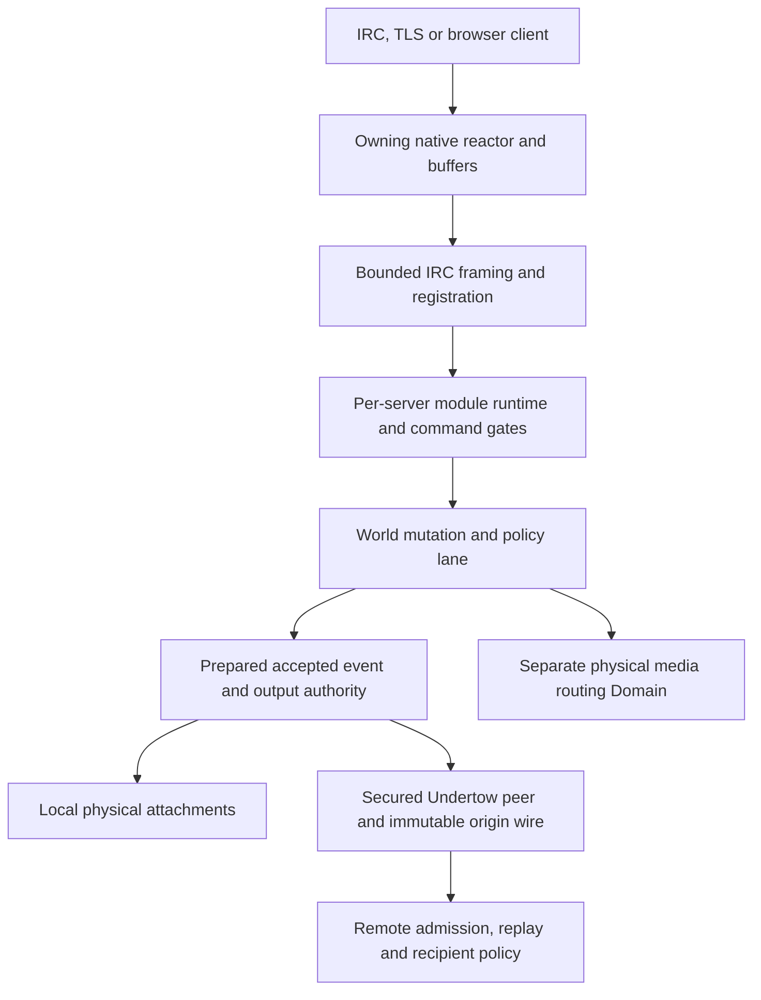

# Onyx Server architecture overview

_System overview of the client-facing daemon, request flow, source map, and the architecture document index._

Onyx Server is a Zig package and daemon executable. The package manifest sets `.minimum_zig_version = "0.17.0"` and lists an empty `.dependencies` table, so the current tree builds from checked-in Zig source. Evidence: `build.zig.zon`. The library root re-exports the major namespaces `crypto`, `daemon`, `proto`, and `substrate`, plus the OroWasm host and browser transport shim roots. Evidence: `src/root.zig`.

This overview covers the client-facing daemon, local world, module dispatch, Ringlane reactor model, media, Helix upgrade, OroWasm, and source-tree orientation. Undertow mesh/S2S and cryptography are summarized here only at subsystem level; see [mesh-s2s.md](mesh-s2s.md) and [crypto.md](crypto.md) for their deeper design.

## Major subsystems

| Area | Current source of truth | What it owns | Evidence |
| --- | --- | --- | --- |
| Build/package | `build.zig`, `build.zig.zon`, `etc/systemd/onyx-server.service` | Zig package metadata, `onyx-server` executable, focused test/run steps, ReleaseFast package staging, systemd unit, 64-bit daemon target guard | `build.zig`, `build.zig.zon`, `etc/systemd/onyx-server.service` |
| Daemon server | `src/daemon/server.zig` | Native daemon transports, connection table, registration integration, live stores, registry/WASM dispatch, media/upgrade wiring | `src/daemon/server.zig` |
| Ringlane I/O | `src/daemon/ringlane.zig`, `src/daemon/reactor_backend.zig`, `src/daemon/server.zig` | Production Linux io_uring ring: probed multishot accept and wake-poll, completion queue sized for a reactor batch, cooperative task-work, provided-buffer multishot recv copied into the connection buffer, and zero-copy send held until the notification. kTLS stays on the copy path. Fixed files and `DEFER_TASKRUN` stay off. `src/substrate/io/ring.zig` is not this backend. | `src/daemon/ringlane.zig`, `src/daemon/reactor_backend.zig`, `src/daemon/server.zig` |
| Connection classes | `src/daemon/conn_class.zig`, `src/daemon/server.zig` | Named per-connection policy: sendq/recvq ceilings, max_clients/per_ip/channels, timeouts, TLS/SASL requirements, flood control, nick-delay exemption; CIDR/TLS/account/oper/ident/host matching; per-class assignment at registration | `src/daemon/conn_class.zig`, `src/daemon/server.zig` |
| Nick delay | `src/daemon/nick_delay.zig`, `src/daemon/server.zig` | Held-nick registry; holds a released nick for a configured window to prevent nick camping; per-account reclaim and oper/class bypass | `src/daemon/nick_delay.zig`, `src/daemon/server.zig` |
| Pre-registration dispatch | `src/daemon/dispatch.zig` | PASS/NICK/USER/CAP/AUTHENTICATE/PING/PONG/QUIT, CAP/labeled-response handling, welcome burst | `src/daemon/dispatch.zig` |
| Protocol inventory | `src/proto/protocol_inventory.zig` | Canonical network name, server name, ISUPPORT tokens, CHANMODES, runtime advertised-limit override | `src/proto/protocol_inventory.zig` |
| Local world | `src/daemon/world.zig` | Nick ownership, channel membership, topics, modes, bans, invitations, RCU mirrors, local-only state | `src/daemon/world.zig` |
| Undertow CRDT mesh | `src/substrate/undertow/root.zig`, `src/substrate/undertow/mesh.zig`, `src/substrate/undertow/s2s_peer.zig`, `src/daemon/secured_s2s_link.zig` | CRDT/gossip mesh primitives, S2S peer driver, route/membership state, secured live S2S integration | `src/substrate/undertow/root.zig`, `src/substrate/undertow/mesh.zig`, `src/substrate/undertow/s2s_peer.zig`, `src/daemon/secured_s2s_link.zig` |
| Membership repair | `src/daemon/server.zig` | Reactor 0 re-bursts the full local roster to every established peer about every 30 seconds (`membership_resync_interval_ms`); cost grows with peers times the local roster. A two-node link dies on ping timeout. Ripple is a library, not on the daemon timer. | `src/daemon/server.zig` |
| Mooring handshake | `src/crypto/mooring_handshake.zig`, `src/crypto/mooring_session.zig`, `src/proto/mooring.zig`, `src/daemon/secured_s2s_link.zig` | S2S secure-channel handshake, session record layer, frame-family admission, Helix resume state for secured links | `src/crypto/mooring_handshake.zig`, `src/crypto/root.zig`, `src/daemon/secured_s2s_link.zig` |
| Armor TLS | `src/crypto/root.zig`, `src/crypto/tls*.zig`, `src/daemon/tls_conn.zig` | Pure Zig TLS policy, client/server handshakes, record layer, kTLS adapter, TLS resume/export state | `src/crypto/root.zig`, `src/daemon/tls_conn.zig` |
| SerpentRegistry modules | `src/daemon/registry.zig`, `src/daemon/modules/manifest.zig`, `src/daemon/modules/*.zig` | Comptime module metadata, validated command/hook/cap tables, gated command dispatch, MODULES/COMMANDS introspection | `src/daemon/registry.zig`, `src/daemon/modules/manifest.zig`, `src/daemon/registry.zig` |
| Reactor/threading | `src/daemon/server.zig`, `src/daemon/ringlane.zig`, `src/daemon/reactor_pool.zig`, `src/daemon/reactor_fabric.zig` | Per-reactor connection slabs, the live Ringlane ring, optional worker pool, cross-shard delivery fabric. Completions stay under the shared world write lock. | `src/daemon/server.zig`, `src/daemon/reactor_pool.zig`, `src/daemon/reactor_fabric.zig` |
| Media | `src/substrate/undertow/media.zig`, `src/daemon/media_room.zig`, `src/daemon/media_plane.zig`, `src/daemon/native_media_transport.zig`, `src/daemon/media_bridge.zig` | SFU participant model, per-channel rooms, RTP/STUN media plane, native CadenceVox/CadenceVis UDP leg, cross-leg rewrap | `src/substrate/undertow/media.zig`, `src/daemon/media_room.zig`, `src/daemon/media_plane.zig`, `src/daemon/native_media_transport.zig`, `src/daemon/media_bridge.zig` |
| Helix upgrade | `src/daemon/modules/upgrade.zig`, `src/daemon/server.zig`, `src/daemon/helix/live.zig`, `src/daemon/helix/handoff.zig` | UPGRADE command, sealed memfd arena, listener/session fd inheritance, successor adoption | `src/daemon/modules/upgrade.zig`, `src/daemon/server.zig`, `src/daemon/helix/live.zig`, `src/daemon/helix/handoff.zig` |
| OroWasm | `src/wasm/host/*`, `src/wasm/cadence_wasm.zig`, `src/wasm/browser_transport.zig` | Control-plane plugin interpreter/bridge/capabilities and browser CadenceVox/CadenceVis exports | `src/wasm/host/interp.zig`, `src/wasm/host/bridge.zig`, `src/wasm/cadence_wasm.zig`, `src/wasm/browser_transport.zig` |
| OroStore persistence | `src/daemon/store.zig`, `src/daemon/services.zig`, `src/main.zig` | Embedded WAL/snapshot persistence, services account/channel state, storage config, account-store boot integration | `src/daemon/store.zig`, `src/daemon/services.zig`, `src/main.zig` |
| Event Spine | `src/daemon/event_spine.zig`, `src/daemon/event_history.zig`, `src/daemon/event_collapse.zig`, `src/daemon/server.zig` | Typed operator/observer events: `EVENT` category subscription and severity filtering, `OBSERVE` mask feed, `EVENT REPLAY` history ring, `EVENT STATS`, IRCv3 message-tags, flood-collapse | `src/daemon/event_spine.zig`, `src/daemon/event_history.zig`, `src/daemon/event_collapse.zig` |
| Web Push | `src/crypto/webpush.zig`, `src/daemon/webpush.zig` | Browser push for offline DMs: RFC 8291 content encryption plus RFC 8292 VAPID, background delivery worker, ISUPPORT `VAPID=` discovery, account-scoped subscriptions | `src/crypto/webpush.zig`, `src/daemon/webpush.zig` |
| Host cloaking | `src/proto/cloak.zig`, `src/daemon/config_format.zig`, `src/daemon/server.zig`, `src/daemon/whois.zig` | Keyed-HMAC v2 IP cloaks, hierarchical or opaque mode, per-account cloak, rotatable key with ban continuity, GeoIP/ASN mixing, oper-only real host/certfp in WHOIS | `src/proto/cloak.zig`, `src/daemon/config_format.zig`, `src/daemon/server.zig`, `src/daemon/whois.zig` |
| Observability / stats | `src/daemon/chanstats.zig`, `src/daemon/server.zig` | Per-channel statistics engine, JSON dashboard feed, USR2-durable binary snapshot, dead-channel prune, and public `status.json` mesh-health feed | `src/daemon/chanstats.zig`, `src/daemon/server.zig` |

## Build, Test, And Package Surface

The build graph is part of the architecture, not only developer tooling. It exposes
the operational lanes used to keep the daemon deployable:

| Step | Role |
|---|---|
| `check` | Type-checks the daemon without emitting a binary. |
| `test-smoke` | Fast inner-loop gate for semantic, TLS, server, and config behavior. |
| `test-roadmap` | Server-roadmap gate spanning server/config/IRCX/event/mesh/services/TLS. |
| `test-media` / `test-helix` | Focused media and upgrade lanes kept independently runnable. |
| `test-mesh` / `test-tls` / `test-server` / `test-ircx` | Focused subsystem suites for Undertow, Armor TLS, daemon integration, and IRCX behavior. |
| `test-cli` | Tests for the standalone `armor` crypto toolkit (openssl-parity verbs over the Armor substrate). Evidence: `build.zig`. |
| `all-checks` | Deterministic pre-push gate: check, WASM build, full tests, fuzz corpus replay, and BoGo shim self-tests. |
| `tools/bogo.sh` / CI `bogo` | External pinned BoringSSL interoperability gate with exact non-vacuous pass/skip baseline enforcement. |
| `release` | ReleaseFast stripped production binary. |
| `package` | ReleaseFast daemon plus reference config and systemd unit staged into the install prefix. |

Verbose test variants use `tools/verbose_test_runner.zig` to print each test name,
duration, summary counts, and the slowest tests, which makes long daemon suites
observable in CI and tmux.

Unfiltered native POSIX full tests use an exhaustive inventory across module,
executable and CLI roots, with bounded parallel runners and retained shard logs.
Verified complete timing profiles balance later runs; failed/partial profiles
cannot establish acceptance. Test-only build metadata stays stable across
unrelated documentation commits. Cached name filters avoid recompilation during
iteration. Production artifacts retain real revision metadata. See
[testing](../guide/testing.md) for exact commands, count rules and current timings.

## Ownership and acceptance flow

The Linux reactors own their sockets and buffer lifetimes; the shared mutation
lane serializes policy/publication. The diagram is an ownership map, not a claim
that every command is MESSAGE_V2 or that every media packet enters IRC history.

Example: a channel PRIVMSG passes sender/channel policy, prepares the signed
MESSAGE_V2 identity and retained custody, commits accepted state, then renders to
eligible physical attachments and secured peers. A rejected/OOM attempt must not
advance replay authority or consume slowmode. A different path such as EVENT is
a notification stream with its own replay/queue limits. See the
[feature index](../reference/features.md) for all public surfaces and detailed
[development guidance](../development.md) for extending them.

## End-to-end client request flow

| Step | Flow | Evidence |
| --- | --- | --- |
| 1 | `runOnce` binds the current thread to its reactor, performs the mesh auto-connect boot pass on reactor 0, arms accept/wake/timer operations, waits for at least one io_uring completion, reaps completions, drains cross-shard fabric if present, then drains webhook posts. A multishot accept or wake stays armed while the kernel sets MORE. | `src/daemon/server.zig`, `src/daemon/ringlane.zig` |
| 2 | A recv completion calls `handleRecv`: inbound bytes flow through `driveClientBytes`, kTLS control records are demuxed by the kTLS path, and S2S links are routed to the secured/plain S2S drivers before ordinary client/TLS handling. | `src/daemon/server.zig` |
| 3 | Complete client lines accumulate through the RecvQ, then `processLiveLine` parses them with the shared IRC line parser. The parser strips CR/LF endings, rejects embedded NUL/line breaks, supports tags and prefixes, and caps params/tags. | `src/daemon/server.zig`, `src/proto/irc_line.zig` |
| 4 | Before registration, the server handles IRCX enable/query and pre-away locally, then calls `processLine`, which adapts into `dispatch.dispatchLine`. | `src/daemon/server.zig` |
| 5 | When `dispatchLine` completes registration, the server applies the visible host, registers the nick in `World`, sends LUSERS/MOTD, enforces Warden/DNSBL/SACCESS/class admission, applies seen/session/autojoin/offline-delivery hooks, assigns the connection class, emits the local welcome, fires the registry `client_registered` hook, and evaluates nick protection. | `src/daemon/server.zig` |
| 6 | After registration, PING still uses `processLine`, but other lines enter `dispatchRegistered`. | `src/daemon/server.zig` |
| 7 | `dispatchRegistered` refreshes the world's wall-clock, routes multiline batches if negotiated, dispatches through SerpentRegistry, then through OroWasm plugins, then falls back to the lower registration-handshake processor for handshake verbs. | `src/daemon/server.zig` |
| 8 | Finished output is queued to a connection-local send buffer (inline plus heap overflow, bounded by per-class `sendq`) or handed to the owning shard through `enqueueDelivery`; send completions drain the buffer and close when needed. Exceeding the SendQ ceiling fails the append. | `src/daemon/server.zig` |

## Source tree map

| Path | Role | Evidence |
| --- | --- | --- |
| `src/main.zig` | Boot CLI, config loading, server initialization, OroStore account-store setup, Helix successor adoption, run loop | `src/main.zig` |
| `src/root.zig` | Public package root and namespace re-exports | `src/root.zig` |
| `src/daemon/` | IRC daemon runtime, world, modules, services, media plane, Helix, the production Ringlane ring, ordinary guest presence, OroStore consumers | `src/daemon/ringlane.zig`, `src/daemon/guest_presence_route.zig`, `src/daemon/server.zig` |
| `src/proto/` | Protocol codecs/builders/inventory used by daemon, modules, mesh links, media, TLS-adjacent codecs, and tests | `src/proto/root.zig` |
| `src/substrate/` | Lower-level runtime primitives: Undertow, the clock seam, queues, EBR/RCU, CRDT structures, and media helpers. `io/ring.zig` can connect, poll, and cancel, and it is not the production ring. | `src/substrate/root.zig`, `src/substrate/reactor.zig`, `src/substrate/io/ring.zig`, `src/substrate/undertow/root.zig` |
| `src/crypto/` | Armor TLS, Mooring handshake/session, primitives, Web Push crypto, X.509 and signing/verification surfaces | `src/crypto/root.zig` |
| `src/wasm/` | OroWasm host, browser transport shim, and CadenceVox/CadenceVis browser exports | `src/root.zig`, `src/wasm/cadence_wasm.zig`, `src/wasm/browser_transport.zig` |

## Architecture index

| Document | Scope |
| --- | --- |
| [00-overview.md](00-overview.md) | System overview, request flow, source map, architecture index |
| [01-reactor-threading.md](01-reactor-threading.md) | Ringlane/io_uring reactor, worker shards, world locking, live multithreading status |
| [02-world-dispatch-modules.md](02-world-dispatch-modules.md) | `World`, preregistration dispatch, SerpentRegistry modules, hooks, introspection |
| [03-media.md](03-media.md) | SFU/session model, media rooms, RTP/STUN plane, native CadenceVox/CadenceVis transport, WASM shims |
| [04-upgrade-wasm.md](04-upgrade-wasm.md) | Helix UPGRADE handoff and OroWasm plugin host |
| [event-spine.md](event-spine.md) | Typed operator/observer event plane: subscription, severity, replay, stats, flood-collapse |
| [observability-stats.md](observability-stats.md) | Channel-statistics engine plus the public `status.json` mesh-health feed |
| [mesh-s2s.md](mesh-s2s.md) | Mesh/S2S architecture; separate document |
| [mesh-security.md](mesh-security.md) | S2S threat model, AEAD record layer, per-frame origin signing, host-cloak federation |
| [crypto.md](crypto.md) | Cryptography architecture; separate document |

## Planning notes and divergences

This architecture set treats the current source as authoritative. The table below records places where the live code has moved ahead of, or diverged from, older design intent.

| Topic | Current-code finding | Evidence |
| --- | --- | --- |
| Registered command dispatch | Current `dispatchRegistered` says daemon-owned post-registration commands are resolved by the registry block; its remaining direct path is the preregistration command processor. This diverges from any older design text that describes a live legacy if/else command chain. | `src/daemon/server.zig` |
| Multithreading | Default config is one shard, but current code can allocate multiple reactors and spawn one worker per reactor when `num_shards > 1`. A nearby comment still says values above 1 are clamped at `runThreaded`, which does not match the current implementation. | `src/daemon/server.zig` |
| Helix session carry-over | `session_snapshot.zig` now documents channel memberships as part of the wire format, and the successor re-joins carried memberships with their member-mode bits. | `src/daemon/helix/session_snapshot.zig`, `src/daemon/server.zig` |
