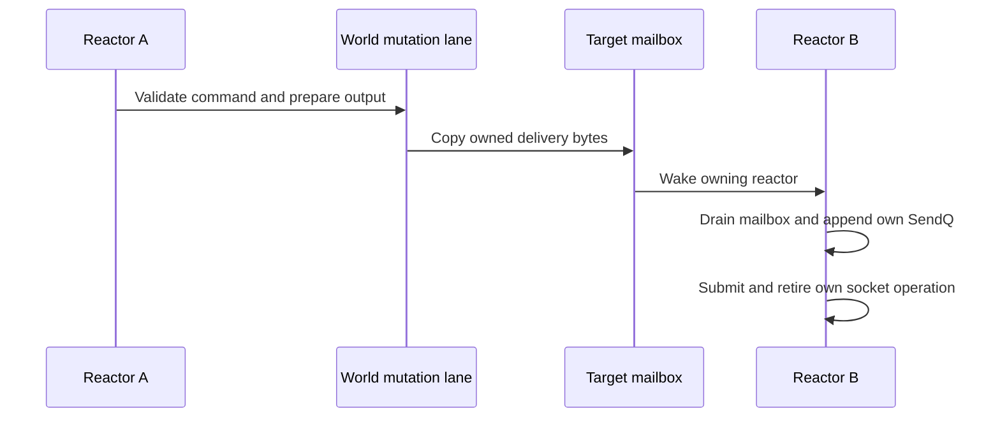

# Reactor and threading

_The live Ringlane io_uring reactor, per-reactor connection state, worker shards, cross-shard delivery, world locking, and the live multithreading status._

The production Linux ring is `src/daemon/ringlane.zig`. The daemon imports it at `src/daemon/server.zig`, and `src/daemon/reactor_backend.zig` selects `ringlane.Ring` on Linux. `src/substrate/io/ring.zig` is the same shape of prototype and is not the daemon backend. The production ring sizes the completion queue to at least 256 and requests cooperative task-work. Accept passes `SOCK_CLOEXEC`. It never requests `DEFER_TASKRUN` or `SINGLE_ISSUER`. On Linux each reactor installs one provided-buffer group and arms multishot recv. The completion is copied into the connection buffer before parse or a Helix snapshot, and the pool slice is replenished. Sends are zero-copy except kTLS TX, and the send buffer stays owned until the notification completion. Fixed files are implemented and are not registered for accepted sockets. `registerAll` stays pure bookkeeping. `src/substrate/reactor.zig` is the separate clock seam. Its header still treats submit, poll, accept, recv, and send as future work for that seam.

The socket path is unchanged: accept TCP, receive IRC bytes through the ring, feed complete LF-terminated lines into the command core, and send queued replies back through the ring.

## Ringlane reactor core

This section describes the current source contract. Complete Debug and ReleaseSafe
release gates are recorded in the [2026-11-03 audit](../audit/release-and-test-speed-2026-11-03.md);
focused Ringlane checks alone are not release acceptance.

| Behavior | Contract | Evidence |
| --- | --- | --- |
| Open | `Ring.init` probes multishot accept and multishot wake-poll, then opens the ring. A probe that cannot decide leaves that operation one-shot. A definitive yes or no is cached for the process. | `src/daemon/ringlane.zig` |
| Completion queue | At least 256 entries, four times the submission queue, capped at 32768, then rounded up to a power of two. The default submission queue is 32 and the default reap batch is 256, so the old kernel default of twice the submission queue was too small. | `src/daemon/ringlane.zig` |
| Cooperative task work | The first setup attempt requests `IORING_SETUP_COOP_TASKRUN`, `IORING_SETUP_TASKRUN_FLAG`, and `IORING_SETUP_CQSIZE`. Only `error.ArgumentsInvalid` walks a shorter ladder. | `src/daemon/ringlane.zig` |
| Closed setup bits | `IORING_SETUP_DEFER_TASKRUN` and `IORING_SETUP_SINGLE_ISSUER` are never passed to the kernel, including when `[io].defer_taskrun` is true. | `src/daemon/ringlane.zig` |
| SQPOLL | Opt-in through `[io].sqpoll`. The flag stays on every ladder attempt until the kernel returns `ArgumentsInvalid`. | `src/daemon/ringlane.zig` |
| Accept | Multishot accept with `SOCK_CLOEXEC` when the probe succeeded. The arm stays up while `IORING_CQE_F_MORE` is set and clears on the terminal completion. | `src/daemon/ringlane.zig` |
| Wake poll | Multishot poll on the reactor eventfd when the probe succeeded. `wake_armed` clears only when MORE is clear. Each completion drains the eventfd. | `src/daemon/ringlane.zig`, `src/daemon/server.zig` |
| Recv and send | Linux with a provided-buffer group uses multishot recv. The bytes are copied into `recv_buf` and the pool slice is replenished before the latch drops. `recv_armed` stays set while `IORING_CQE_F_MORE` is set. `ENOBUFS` rearms instead of closing. Zero-copy send keeps `send_armed` until `IORING_CQE_F_NOTIF`. kTLS stays on one-shot copy recv and send. Fixed files are not on this path. | `src/daemon/ringlane.zig`, `src/daemon/server.zig` |
| Overflow | Submit flushes `IORING_SQ_CQ_OVERFLOW` and retries once when the completion queue is overcommitted. | `src/daemon/ringlane.zig` |
| Listener adoption | Shard 0, when `s2s_port` is not 0, dups an inherited S2S listener and adopts that fd. The caller keeps the original. Port 0 still means no S2S listener. | `src/daemon/server.zig` |
| World lock | Completions are handled under the shared world write lock. Reactors parallelize I/O and serialize command processing. | `src/daemon/server.zig` |

`[io].defer_taskrun` remains a parsed key. `--check-config` still rejects it together with `sqpoll`. That rejection does not mean the live ring arms deferred task-run.

`src/substrate/io/buf_ring.zig` keeps pure provided-buffer bookkeeping. `registerAll` does not call the kernel. The production ring registers one group through `LiveBufRing` when Linux boot sets `buf_ring`. A kernel that rejects the group leaves that reactor on copy recv. The group is at least twice `max_clients`, rounded up to a power of two, and capped at 32768 entries of `default_recv_bytes`.

Source references use stable files and symbols rather than old absolute line offsets.
The ownership model is: one reactor owns its ring, clients, and listener fds; another reactor does not touch those fds.

## Per-reactor state and connection classes

`LinuxServer` stores a heap slice of `Reactor` structs. Each `Reactor` owns its ring, connection table, listener fds, timer/wake state, and shard id. Evidence: `src/daemon/server.zig`.

Each connection is assigned a **connection class** by matching the connection's source IP (IPv4 and IPv6 CIDR), TLS status, SASL authentication, oper status, and ident/host glob patterns. The first matching class wins; S2S links resolve to the built-in `server` class and unmatched client links fall back to `user`. Evidence: `src/daemon/conn_class.zig`, `src/daemon/server.zig`.

| Field | Ownership rule | Evidence |
| --- | --- | --- |
| `ring` | Owned by one reactor thread for accept/recv/send/poll/timeout completions. | `src/daemon/server.zig` |
| `clients` | Connections are pinned to a reactor-local slab; another reactor must not touch their fd/send buffers directly. | `src/daemon/server.zig` |
| `shard_id` | Stamped into `ClientId.shard`; always 0 in single-reactor configuration. | `src/daemon/server.zig` |
| listener fds | Plaintext, optional S2S, optional implicit TLS, and optional secure-WebSocket listener fds live per reactor; S2S is reactor-0-only in sharded mode. | `src/daemon/server.zig` |
| wake fd | A per-reactor eventfd may be polled so another thread can wake the loop and drain that shard's mailbox. | `src/daemon/server.zig` |

The current reactor is held in `threadlocal var current_reactor`, and handlers call `self.rx()` to resolve the current thread's reactor or fall back to reactor 0 outside reactor threads. Evidence: `src/daemon/server.zig`.

## SendQ and RecvQ

Every connection has a **SendQ** (outbound) and a **RecvQ** (inbound) bounded by the per-class policy, applied when `assignConnClass` runs.

| Buffer | Structure | Ceiling | Evidence |
| --- | --- | --- | --- |
| **SendQ** | Inline send buffer (`send_buf`) plus a heap-allocated overflow queue. The kernel reads only the fixed inline buffer; overflow refills the inline buffer on send completion. | Per-class `sendq` ceiling (default 1 MiB for user class, 8 MiB for server class). | `src/daemon/server.zig`, `src/daemon/conn_class.zig` |
| **RecvQ** | Inline line buffer (`line_buf`) accumulates the current unterminated line; overflow spills to a heap queue. | Per-class `recvq` ceiling (`0` = physical line-buffer default). A line exceeding this ceiling closes the connection with `LineTooLong`. | `src/daemon/server.zig`, `src/daemon/conn_class.zig`, `src/daemon/server.zig` |

Both overflow queues share the connection's `overflow_allocator`; SendQ overflow is drained back into `send_buf`, and RecvQ overflow is released on reset after a completed line. Evidence: `src/daemon/server.zig`.

## Initialization

| Step | Behavior | Evidence |
| --- | --- | --- |
| Shard count | `clampShards` converts zero to one, caps at `shard.max_shards`, and returns at least one. | `src/daemon/server.zig` |
| Listener selection | The plaintext listener is created with SO_REUSEPORT even for one shard so a later 1-shard to N-shard upgrade can bind siblings. Sharded TLS and secure-WebSocket client listeners also use SO_REUSEPORT; the S2S listener is bound only by reactor 0. | `src/daemon/server.zig` |
| Per-reactor ring | `initReactor` creates the listener fds, Ringlane ring, reserved client slab, shard-local client table, and wake handle. | `src/daemon/server.zig` |
| Server reactor slice | `LinuxServer.init` allocates `reactors` with length `shard_count` and initializes each entry. | `src/daemon/server.zig` |
| Shared world/stores | `LinuxServer` owns shared world and stores separately from per-reactor I/O; the worker pool is initialized alongside the server-level state. | `src/daemon/server.zig` |

## Run loop

| Mode | Behavior | Evidence |
| --- | --- | --- |
| `runOnce` | Binds reactor 0 if no thread-local reactor is set, arms accept/wake/timer, waits for a completion, reaps CQEs, drains fabric if present, drains webhook posts, and submits pending SQEs. | `src/daemon/server.zig` |
| Completion boundary | Each decoded completion is handled under one shared `world.lockWrite`; per-reactor clients, send buffers, and rings remain reactor-local. | `src/daemon/server.zig` |
| Single reactor | `runThreaded` runs `runLoopResilient` inline when `self.reactors.len <= 1`; no pool and no fabric are used. | `src/daemon/server.zig` |
| Multi reactor | For more than one reactor, `runThreaded` creates a cross-shard fabric, starts one worker thread per reactor, and joins the pool. If fabric or pool startup fails, it falls back to the single-reactor loop. | `src/daemon/server.zig` |
| Worker | Each worker sets `current_reactor` to its shard and loops through `runLoopResilient`/`runOnce` while the run flag is true. | `src/daemon/server.zig`, `src/daemon/reactor_pool.zig` |

## Cross-shard delivery

When a command needs to write to a connection, `enqueueDelivery` is the central shard-aware sink. Local writes append directly to the owning reactor's connection; cross-shard writes copy bytes into pooled buffers, enqueue them into the target shard mailbox, and wake the target reactor. Evidence: `src/daemon/server.zig`.

`ReactorFabric` is runtime-sized by shard count and owns one MPMC inbox and one wake eventfd per shard plus a shared pooled-buffer allocator. The live daemon currently wakes the target reactor through `Reactor.wake`, not the fabric's own wake fds, because the reactor loop polls `Reactor.wake`. Evidence: `src/daemon/reactor_fabric.zig`, `src/daemon/server.zig`.

| Fabric operation | API | Evidence |
| --- | --- | --- |
| Copy bytes into pool | `acquire(bytes)` returns a `DeliverBuf` or null. | `src/daemon/reactor_fabric.zig` |
| Enqueue | `sendTo(target, msg)` pushes into the target shard inbox. | `src/daemon/reactor_fabric.zig` |
| Drain | `drain(target, out)` is called by the owning reactor. | `src/daemon/reactor_fabric.zig`, `src/daemon/server.zig` |
| Wake | `wake(target)` pokes a fabric eventfd, while live cross-shard delivery wakes `self.reactors[id.shard].wake`. | `src/daemon/reactor_fabric.zig`, `src/daemon/server.zig` |

## Worker pool

`ReactorPool` is the generic worker-thread harness for the sharded model. It spawns one thread per shard, passes each a distinct shard index, shares only a cooperative `RunFlag`, and joins every worker on shutdown. Evidence: `src/daemon/reactor_pool.zig`.

## World locking

The shared `World` owns an `RwLock`. Current comments say lookups take the read lock, mutations take the write lock, and every mutation/allocation happens under the exclusive lock. Evidence: `src/daemon/world.zig`.

The world also has lazily activated RCU mirrors for nick lookup and channel existence/membership. The RCU model is implemented in `world_rcu.zig`: readers pin EBR and traverse immutable HAMT snapshots without locks or allocation; writers serialize, copy-on-write, publish a new root, and retire old state. Evidence: `src/daemon/world.zig`, `src/daemon/world_rcu.zig`.

## Is multithreading live?

Yes, conditionally. The default configuration is one shard, but the current source creates multiple reactors when `config.num_shards > 1`. In that case it initializes a reactor slice, starts a cross-shard fabric, and spawns one worker thread per reactor. Evidence: `src/daemon/server.zig`.

The test suite contains threaded server coverage for multi-reactor startup and cross-shard behavior. It asserts `num_shards = 4` produces four reactors, and `num_shards = 2` cross-shard tests skip only when fewer than two reactors are available. Evidence: `src/daemon/server.zig`.

## Planning notes and divergences

Current code diverges from older design intent in one important inline comment: `Config.num_shards` still says values greater than 1 are clamped to 1 at `runThreaded`, but the implementation starts the multi-reactor pool when `reactors.len > 1`. Evidence for the stale comment: `src/daemon/server.zig`; evidence for current behavior: `src/daemon/server.zig`.

## Cross-shard example

If the command on A targets a client owned by B, A must not borrow B's socket or
mutate its SendQ. B receives owned data and retires its own kernel operations.
Backpressure and ownership transfer need explicit retry/refusal behavior; a
successful mailbox enqueue is not proof that the remote IRC client consumed bytes.
Linux TERM/INT stop observation belongs to reactor 0 and must remain observable
across worker creation and compatible Helix exec. See [upgrade architecture](04-upgrade-wasm.md).
