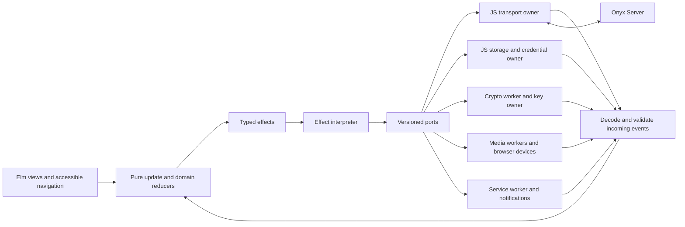
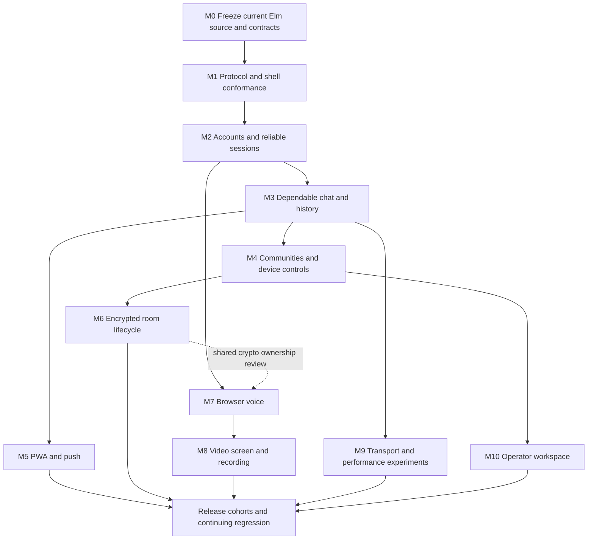

# Onyx Elm client roadmap

Planning baseline: **2026-11-03**. Server source reviewed at
`b9be884cce57dadf91d415f61e703de95e521757`; source manifest version **0.9.0**.
The recorded deployed artifact on both nodes is **0.9.0+5bdd9dc55d99**, from
`5bdd9dc55d99527a9195883b392f8a7e93d90a2e`, with SHA-256
`2dcc899051a71637116bbe270bf528fdff153b26ef4f68e136458eb56490c6c0`.
These are separate source and runtime baselines. This document does not deploy
anything or certify a client release.

This is the implementation roadmap for taking advantage of Onyx Server from
the **existing Elm Onyx client in `/home/kain/onyx/elm`**. The user identified
that client repository and authorized the read-only audit used here. Its Git
HEAD was `55bfa9cf2d37aed5523ea021d06e4e951d907e03`, with substantial modified and
untracked Elm work. The inspected working files, including that work, are the
client baseline; HEAD alone does not reproduce it. The older SolidJS tree and
root documentation describe the previous implementation. This is an extension
and hardening roadmap for Elm, not a SolidJS migration or a new client rewrite.

The proposed storage schemas, feature flags, test IDs and milestones below are
design work. Existing implementations are identified separately. This audit did
not run the client test suites or establish browser/live-server acceptance.
The earlier [client integration outline](onyx-client-integration-2026-10-26.md)
remains the requirements baseline; its server-roadmap IDs and user journeys
remain useful traceability, rather than a second execution queue.

The recommended first release gate is dependable browser chat: preserve the
implemented account, channel, DM, history and IRCX work while correcting current
server-contract gaps, reconnect outcomes and send/read-state evidence. Rich IRCX
community usability follows. Encrypted rooms, browser voice, video, and operator
workspaces each have independent release gates.
Implementing every raw command as a button is not the product objective.

## How to use this roadmap

Start with the [actual Elm baseline and gaps](#1-evidence-and-readiness-rules),
then use the [existing architecture map](#3-extend-the-existing-elm-architecture)
and [ordered milestones](#12-milestones-and-ordered-backlog) for implementation.
Each milestone names the user value, existing work to preserve, corrections or
extensions, dependencies, relative size, acceptance and rollback. The
[test catalog](#13-verification-design-and-acceptance-evidence),
[server prerequisites](#14-release-flags-compatibility-and-server-prerequisites)
and [contract drift](#15-machine-contracts-drift-and-canonical-interpretation)
are the review checklist. Begin with E00–E04, E11, E12 and E22; avoid reopening
completed client capabilities as new greenfield projects.

## 1. Evidence and readiness rules

Use four independent observations for every feature:

1. **Source:** a current handler, runtime owner and tests exist.
2. **Configuration and permission:** the endpoint has enabled the feature and
   the caller is authorized; a registry name or CAP token alone is insufficient.
3. **Deployment:** the particular server artifact and configuration have
   relevant runtime evidence.
4. **Client:** this client revision passes the feature's browser and user-journey
   acceptance tests against that deployment.

The [feature index](../reference/features.md),
[command index](../reference/commands/_index.md), live source and tests establish
the first observation. The [release audit](../audit/release-and-test-speed-2026-11-03.md)
and [runtime record](../ops/onyx-server-paths.md) establish the bounded existing
fleet evidence: both nodes report secured mesh health, including
`links_active=1`, `peers_up=1`, `partitioned=0`. Those observations do not certify
Web Push delivery, a browser media call, client encryption, or all session-control
variants. This roadmap adds no new live acceptance receipt.

The current fleet also has WebTransport enabled, which the recorded operational
receipt identifies as a Helix continuity blocker. Its accepted rollout used the
supported cold-restart boundary. Old composite-token continuity across that cold
boundary is not accepted. Later references to sequential **supported** upgrades
are proposed compatibility tests in a configuration that actually permits the
chosen upgrade path, not a promise of live-fleet seamless Helix today.

### Actual Elm baseline and immediate deltas

The audited client uses **Elm 0.19.1**, `elm/browser` **1.0.2**, and
`elm-explorations/test` **2.2.0**. `elm/index.html` initializes `Elm.Main` and
`OnyxPorts.wire`; `elm/ports.js` supplies standalone browser implementations.
References there to TypeScript oracles record implementation lineage; the
audited entrypoint does not simply import the old SolidJS runtime.

The inventory contains **108 Elm source files, 81 Elm test files and 59 JavaScript
smoke files**. These are file counts, not passing tests. `elm/COVERAGE.md` contains
historical parity and pass claims, which should be refreshed against the current
working tree before release. Legacy-oracle parity is useful regression evidence;
an old client omission is not grounds to omit a useful current server capability.
For example, the coverage notes distinguish oracle gaps for bouncer UI,
netsplit/netjoin rendering and some services/list results.

The planning audit records hashes of eleven key working files in the local
evidence artifact `.zig-cache/elm-client-roadmap/client-source-manifest.json`
under the server repository. This is a bounded source observation, not a complete
client source manifest or acceptance receipt. Preserve all unrelated and untracked
client work; implementation should freeze a complete reproducible source cut
before claiming a release. No client file was changed by this roadmap task.

| Area | Existing Elm implementation observed | Work to prioritize |
|---|---|---|
| Application | `Main.elm` uses `Browser.application`; `App.elm` owns pure model/update; `View/*.elm` renders the shell | Extend existing architecture; extract bounded reducers from the large App module behind behavior fixtures |
| Wire/negotiation | `Wire.elm`, `Isupport.elm`, `Session.elm`, `Labels.elm`, App CAP folds and JS WSS/SASL | Repair broad `wantedCaps` selection; validate current escaped/multi-line ISUPPORT and browser subprotocol behavior |
| Session restore | `Session.planSessionReclaim`, `App.maybeSendSessionCommands`, `Credentials.elm`, local list/drop UI | Replace timer-confirmed recovery with authoritative outcomes; add exact-kind/issuer/redirect handling and full failure taxonomy |
| Chat/history | `Spine.elm`, `EventReplay.elm`, `Transcript.elm`, `Search.elm`, `MessageWindow.elm`, App history requests | Preserve merge/windowing; test current server pagination, history/live split, equal timestamps and oracle-gap features |
| Outbox | `Outbox.elm` plus JS durable `wire_admitted`, held uncertain state, `q` labels, expiry and 100-entry bound | Preserve existing no-resend handling; verify timeout/ACK/eviction/reload UI semantics without treating labels as idempotency |
| IRCX/community | `Ircx.elm`, `Modes.elm`, `Services.elm`, `Moderation.elm`, View/App folds | Turn current builders and partial flows into complete server-authorized product journeys |
| DM encryption | `DmCipher.elm`, `Keyring.elm`, ports crypto and private key/pin storage | Preserve ONYXDM1/open-lock behavior and audit key-change, account switch, pin recovery and device lifecycle |
| Room encryption | GroupControl/Directory/Publisher/Commit/Welcome/Session/Envelope modules and ports | Receive/verify/pair/install paths exist; prove complete creation, membership rotation, sender welcome authoring and recovery before release |
| Media | Media/Cadence/RoomMedia modules, binary WS adapter and ports | Actual capture/playback relies on `window.OnyxVoiceEngine`; no engine injection was found in inspected entrypoint/staging, so close that product integration gap |
| Push/PWA | `Push.elm`, `createWebPush`/`wireWebPush`, subscription smokes; app-shell `elm/sw.js` | Register worker and implement push/click/subscription-change lifecycle; existing worker only handles install/activate/fetch |
| Rendering | MessageWindow default 120/max 720 rendered rows, thread windows, real View modules | Measure and improve existing bounds/accessibility instead of rebuilding virtualization |
| Build/tests | `tools/build-elm-site.mjs`, Elm tests, port smoke suites, `test:e2e:elm` mock Chromium setup | Establish fresh focused then full client evidence; mock browser tests are not live mesh/media acceptance |

The first corrections are concrete: `Session.wantedCaps` currently requests
nearly every advertised capability outside a small exclusion set; the client
should instead request only implemented, enabled capabilities with prerequisites.
`App.ReclaimTimerFired` can move `Restoring` to `Reclaimed` on elapsed time;
elapsed time is not proof of a successful SESSION restore. Those issues are
**repair work**, not reasons to discard the substantial existing implementation.

### Capability-to-product matrix

| Server surface | Source status and important boundary | Client product use | Release posture |
|---|---|---|---|
| IRC registration, WSS, CAP, ISUPPORT | Live; no STARTTLS; CAP and `005` are different inventories | Connection setup and adaptation | Foundation, M1 |
| SASL/account services | Live configured mechanisms; account, factor and TLS policy differ | Login, registration, account recovery | M2; mechanisms enabled individually |
| `SESSIONTOKEN` / SASL `SESSION-TOKEN` | Durable account continuation; rotation replaces the current account token | Optional remember-account flow | M2; not attachment restoration |
| `SESSION TOKEN` / `SESSION RESUME` | Live logical and composite physical restore; issuer/retention limits apply | Resume conversation without disrupting siblings | M2, with failure-state tests |
| `SESSION LIST`, local `DROP` | Live account-scoped local physical selectors | Manage local connections | M2/M4 |
| `SESSION LIST MESH`, group `REVOKE` | Candidate contract and implemented paths; pagination acceptance is explicitly incomplete in the supplement | Mesh device/session management | Gated M4; no full-mesh guarantee by default |
| `PRIVMSG`, `NOTICE`, tags, stable `msgid`/`time` | Live; MESSAGE_V2 admission and mesh exact-once have a specific server scope | Chat, replies, reactions, clear send state | M3 |
| CHATHISTORY, SEARCH, MARKREAD, bouncer rewind | Live bounded history/index and visibility rules; no unlimited archive promise | Catch-up, search, unread state | M3/M4 |
| IRCX PROP/ACCESS/MODEX/LISTX, channel services | Live permission-gated structured channel controls | Community setup and moderation | M4 |
| Privacy/cloaking, CHGHOST, account tags | Live host presentation changes; host is not stable identity | Quiet identity continuity and privacy controls | M2–M4 |
| Group E2EE control and required-room policy | Live server structural policy and opaque control relay; client key lifecycle needs its own audit | Encrypted rooms | M6, off until complete lifecycle acceptance |
| Binary WS media and Cadence WASM exports | Source transport/codec implementation; deployment enablement and real browser interoperability need validation | Browser-to-browser calls | M7/M8, separate from text readiness |
| Native UDP and WebRTC SRTP/DTLS bridge | Source implementation; custom codec compatibility, endpoint authority, network reachability matter | Optional interoperable media | M8 investigation gate, no automatic availability claim |
| WebTransport listener | Live QUIC/HTTP3 listener/proxy path when configured | Optional browser transport | M9 experiment; WSS baseline |
| Recording, captions, hand queue, quality | Commands exist; recording is consented packet journaling; queue is advisory | Call controls with accurate meaning | M8 selectively |
| Web Push | Off by default; local account store, node VAPID key, outbound worker; bounded memo/local-mention/call-invite triggers | Optional background notifications | M5 after public-service/browser tests |
| Setup/doctor JSON, stats, Event Spine, grants | Mixed host CLI and authorized IRC interfaces; no general browser admin API implied | Separate operator workspace | M10 |
| File upload, arbitrary web API, standard Opus/VP8 bridge, TURN allocation | Not established by current client-facing source contracts; `MEDIA TURN` returns `TURN_CUT` | Potential later product work | Explicit server/protocol prerequisite |

The source has 47 CAP names across 46 IDs and 175 distinct command spellings
across its enabled registry and lower connection table. Those counts are an
inventory, not a client implementation target. Use [live CAP metadata](../../src/proto/live_cap_metadata.zig)
and `COMMANDS [name]` to ground feature discovery.

## 2. Product scope, priorities and completion bar

### Priority order

| Priority | User outcome | Included | Deferred until its prerequisite exists |
|---|---|---|---|
| P0 | Chat and recovery are trustworthy | WSS, protocol decoding, login, channels/DMs, drafts, accepted-message merge, reconnect, basic history, keyboard access | Automatic resend of uncertain writes, full mesh device claims |
| P1 | Communities are pleasant to use | Search, threads/replies, reactions, pins, privacy, channel settings, moderation, installable shell and opt-in push | Arbitrary untrusted rich HTML and server-admin controls in ordinary chat |
| P2 | Private conversations and calls are usable | Audited encrypted rooms; browser voice then video/screen; accurate encryption and audience indicators | Mixed-plane media promises without interoperability evidence |
| P3 | Advanced users can operate and extend the network | Operator workspace, diagnostics imports, integrations, experimental transport, measured optimization | A general remote host-management service inferred from CLI commands |

Every released milestone needs: a named client owner and exact revision; server
revision/artifact/config receipt; encoded protocol fixtures; positive and negative
tests; accessibility review of the changed journey; redacted diagnostics;
explicit browser matrix; flag defaults and rollback behavior; and a reviewer
who did not implement the change. A documentation milestone can close with
document checks. A client feature requires client evidence. A server change
requires the repository's corresponding gates.

Effort labels are **relative**, not dates: **S** is one bounded adapter/view;
**M** is a cross-module user journey; **L** is a stateful subsystem; **XL** needs
research or an independent security/interoperability review. Split L/XL work
before scheduling. Existing client capabilities may reduce a slice to an audit
and regression suite; the discovery milestone decides this.

## 3. Extend the existing Elm architecture

Keep the existing The Elm Architecture separation: `Main.elm` owns browser
integration, `App.elm` owns pure transitions, domain modules own codecs/policy,
and `ports.js` owns browser facilities. Tighten that boundary with versioned
schemas and explicit ownership. Elm's official
[effects guide](https://guide.elm-lang.org/effects/) describes `Cmd` and `Sub`;
its [ports guide](https://guide.elm-lang.org/interop/ports.html) includes WebSocket
and storage integration. [elm/browser 1.0.2](https://package.elm-lang.org/packages/elm/browser/1.0.2/Browser)
matches the inspected dependency. M0 freezes the current compiler, packages,
working files and build tools before changing this structure.



### Actual module map and proposed extraction seams

All client paths below are relative to `/home/kain/onyx`. They are code paths
rather than relative Markdown links because they are outside this repository.
Keep these existing modules; proposed extraction seams follow the map.

```text
elm/
  elm.json                   -- pinned Elm application and test dependencies
  index.html                 -- Elm.Main.init and OnyxPorts.wire entrypoint
  ports.js                   -- actual JS browser/crypto/storage/media bridge
  sw.js                      -- existing app-shell worker; push integration pending
  src/
    Main.elm                 -- Browser.application, ports and Outbound interpreter
    App.elm                  -- central pure model/update and feature composition
    Wire.elm                 -- parser, encoding and SASL/protocol helpers
    Isupport.elm             -- negotiated server token projection
    Session.elm              -- capabilities, reclaim plan and session helpers
    Credentials.elm          -- credential-related state/encoding
    Labels.elm               -- labeled-response correlation
    Spine.elm                -- event/message processing
    EventReplay.elm          -- historical/live separation
    Outbox.elm               -- queue model and admission rules
    MessageWindow.elm        -- bounded rendered windows
    Transcript.elm           -- conversation transcript helpers
    Search.elm               -- search state and protocol work
    Retention.elm            -- retained-data policy
    Ircx.elm                 -- extended IRC surface
    Modes.elm                -- rank, modes, MODEX
    Services.elm             -- account/service command builders
    Moderation.elm           -- moderation policy/operations
    DmCipher.elm              -- ONYXDM1 envelope and DM encryption policy
    Keyring.elm               -- opaque room-key handles and bounded epochs
    GroupControl.elm          -- control payload/delivery/pairing
    GroupDirectory.elm        -- trusted device directory
    GroupPublisher.elm        -- own device publication
    GroupCommit.elm           -- commit binding
    GroupWelcome.elm          -- recipient welcome framing
    GroupSession.elm          -- epoch/session transitions
    GroupEnvelope.elm         -- ONYXROOM1 content envelope
    Media.elm                 -- media controls
    Cadence.elm               -- binary frame model/validation
    RoomMedia.elm             -- room/media state
    Push.elm                  -- push subscription state
    Passkey.elm               -- passkey interaction
    Upload.elm                -- existing upload-related client work, server gate required
    View/*.elm                -- current UI, including connection/account/thread views
  tests/*.elm                 -- existing pure regression suites
tools/build-elm-site.mjs       -- optimized Elm site staging, separate from deployment
tests/e2e/elm.config.ts        -- existing mock-browser integration configuration
```

`App.elm` is roughly 41,000 lines in the inspected working tree and `ports.js`
is also substantial. Extract bounded feature reducers and adapter factories
incrementally, after characterizing behavior, rather than replacing them with
the tree of a new framework. Candidate new modules are `App/SessionUpdate.elm`,
`App/HistoryUpdate.elm`, `Ports/Protocol.elm` and focused JS owner files; these
names are proposals only. Keep existing `App.Outbound`/Main interpretation as
the compatibility boundary while extraction proceeds.

Feature reducers should receive only their domain inputs; they do not parse raw wire
strings or reach into another feature's mutable state. The root reducer owns
cross-domain transitions such as account logout, connection replacement,
membership removal, and media teardown.

### State and identity model

Do not use `String` interchangeably for every identifier. Define opaque types
and explicit constructors/decoders for `NetworkId`, `EndpointId`, `AccountId`,
`ConversationId`, `MessageId`, `LogicalGroupId`, `AttachmentId`, `LocalDropSid`,
`RequestId`, `ConnectionGeneration`, and private `CredentialHandle`.

An Elm `Dict` cannot directly use arbitrary custom types as comparable keys.
Keep canonical string keys inside owning modules, expose typed lookup functions,
and prevent callers from constructing cross-domain keys by concatenation.
Avoid rounding remote 64-bit identifiers or timestamps through JavaScript
numbers: carry opaque IDs as canonical strings and keep exact timestamp
fractions alongside any derived display time.

An illustrative type sketch, to refine against actual client conventions:

```elm
type ConnectionState
    = Offline OfflineReason
    | Connecting ConnectionGeneration EndpointId
    | Negotiating ConnectionGeneration
    | Authenticating ConnectionGeneration AuthMethod
    | Restoring ConnectionGeneration ResumeIntent
    | CatchingUp ConnectionGeneration
    | Ready ConnectionGeneration
    | BackingOff RetryPlan

type DeliveryState
    = Draft
    | Queued
    | SentAwaitingEvidence
    | Accepted MessageId
    | Failed SendFailure
    | DeliveryUnknown

type EncryptionState
    = PlaintextAllowed
    | RequiredLocked LockReason
    | EstablishingEpoch EpochId
    | ReadyEncrypted EpochId
    | RecoveringKeys RecoveryReason

type Effect
    = SendCommand ConnectionGeneration RequestId ClientCommand
    | RequestCredential CredentialRequest
    | StoreTransaction StorageTransaction
    | Schedule RetryTimer
    | CryptoOperation CryptoRequest
    | MediaOperation MediaRequest
    | FocusElement String
    | ReportDiagnostic RedactedDiagnostic
```

`ClientCommand` is a validated union, not an arbitrary string. Time and random
IDs arrive as explicit messages/effects. The reducer is pure:
`update : Msg -> Model -> ( Model, List Effect )`; this is a design sketch for
the existing outbound-effect pattern, not a demand to change public types just
to match it. One interpreter translates effects into `Cmd Msg` and ports.
Do not rely on `Cmd.batch` to establish wire
ordering: one transport owner serializes each explicit command sequence.

### Port protocol and secret boundary

Use envelopes such as the following as **proposed local API**, never an IRC
wire extension:

```json
{
  "version": 1,
  "connectionGeneration": "c-17",
  "accountGeneration": "a-4",
  "requestId": "r-106",
  "kind": "transport.send",
  "payload": { "lines": ["CHATHISTORY LATEST #team * 20"] }
}
```

Every asynchronous result returns the ownership generations and request ID.
Reject stale results after disconnect, account change, room leave, key epoch
change, or a replaced capture device. Decoder errors become bounded diagnostic
events; an arbitrary JS value must not crash or mutate trusted state.

| Owner | Responsibilities | Data crossing into ordinary Elm UI |
|---|---|---|
| Transport adapter | WSS/experimental transport, ordered writes, buffered-byte bounds, close events, input size limits | Parsed public records and typed errors |
| Credential adapter | SASL secret payload construction, token capture/storage, private handles, expiry and removal | Account/factor state, credential kind/status, no bearer bytes |
| Storage adapter | IndexedDB transactions, versioned records, quotas, pruning, account separation | Typed nonsecret records or handles |
| Crypto worker | Device private keys, signature verification, room epochs, encrypt/decrypt, ownership checks | Public identity and verification state; bounded transient plaintext only when policy allows |
| Media owner | Devices, codecs/WASM, audio/video frames, cryptographic frame operations, counters | Call state, permissions, levels and sampled statistics, never raw frame floods |
| Service worker | App-shell cache, push rendering, click routing and lifecycle | Notification events with safe routing data |

The audited SASL path already holds password material ports-side rather than
on the ordinary Elm model. Preserve and extend that boundary to every credential
flow, and audit forms that have different ownership. The mandatory invariant is that raw credentials
never enter persisted app models, generic diagnostics, analytics, route URLs,
crash reports or a production time-travel debugger. Merely hiding a value in a
JavaScript object is not isolation from compromised same-origin code.

A worker can reduce accidental data exposure and UI contention; it is not a
complete XSS security boundary. Enforce a restrictive content policy, avoid
untrusted script/HTML, review dependencies, and use an audited storage design.
For browser credential persistence, record the threat model and unlock policy;
do not call IndexedDB or localStorage an OS credential vault. Default to no
durable room secrets until recovery, encryption-at-rest and deletion behavior
have passed M6.

## 4. Protocol foundation and connection lifecycle

### Negotiation

Keep three structures: advertised CAP names/values, acknowledged CAP state,
and accumulated ISUPPORT tokens. Rebuild them on each new physical connection.
CAP LS can span lines; `005` can span several replies and repeat after VERSION.
Merge keys, apply removal semantics when supported, decode value escapes, and
never split a decoded space into another token. Preserve unknown tokens for
diagnostics without inventing support.

The current `Session.wantedCaps` broadly requests advertised capabilities
outside a short exclusion list. Replace that with an explicit supported-feature
policy. Preserve the existing chunked LS/REQ, ACK/NAK and SASL implementations;
add regressions proving that a newly advertised server feature is not automatically
requested. In particular, `onyx/e2ee` needs a usable identity/session lifecycle,
not just advertisement.

Recommended negotiation groups, filtered to the actual LS response:

| Group | Capabilities | Dependency and UX |
|---|---|---|
| Core | `message-tags server-time batch labeled-response echo-message standard-replies` | Enables reliable correlation and timeline metadata; missing members select a documented degraded profile |
| Account/identity | `sasl account-tag account-notify extended-join chghost multi-prefix away-notify setname` | SASL mechanisms come from actual policy; role and account data stay separate |
| History | `draft/chathistory draft/read-marker draft/event-playback onyx/bouncer` | Enable after history/live separation exists; automatic rewind must share the same merge path |
| Rich chat | `draft/search draft/reply draft/react draft/typing draft/message-editing draft/message-redaction draft/channel-rename draft/metadata-2 onyx/topics` | Each feature has separate fallback; do not request unimplemented behavior just because offered |
| Reusable sessions | `onyx/session-sync` | DM sibling mirroring; not portable-resume or complete-inventory authorization |
| Advanced | `draft/multiline extended-monitor draft/channel-context account-extban utf8-only draft/netsplit draft/netjoin` | Parse advertised bounds and batching semantics |
| E2EE | `onyx/e2ee` | Separate activation flag after account/reusable-session and key lifecycle gates; do not negotiate blindly for guests or half-configured runtimes |

Both no-implicit-names spellings share a server ID. Choose one and issue explicit
NAMES only after the client supports the alternative roster flow. The current
Elm App already requests NAMES when either alias is negotiated; preserve that
behavior and test both aliases. The helper exclusion/comment mismatch is not
evidence of a missing roster in the current caller path. The current
static cap set does not emit NEW/DEL; preserve a parser path for future updates
without assuming they will arrive. Unknown/unavailable CAP requests NAK the
whole request. Request groups deliberately and retry a smaller supported group
without marking any NAKed item negotiated.

Example sequence, with only offered capabilities and the mechanism's real
challenge exchange inserted before CAP END:

```irc
CAP LS 302
CAP REQ :message-tags server-time batch labeled-response echo-message standard-replies
CAP REQ :sasl account-tag account-notify extended-join chghost onyx/session-sync
NICK alice
USER onyx 0 * :Alice
AUTHENTICATE SESSION-TOKEN
```

Do not send the placeholder token or assume this mechanism is offered. Complete
its exact SASL encoding/chunking and process `900`/`903`, or its explicit failure,
then send `CAP END`. A remembered account credential authenticates; the later
SESSION flow selects session authority. If attempting a registered account nick,
authenticate before releasing registration rather than racing ownership checks.
If using a post-registration passkey ceremony, first connect under an allowed
temporary nick, authenticate, then explicitly reconcile nick/session state.

### Parser and command encoder

Harden the existing `Wire.elm` parser/encoders against [irc_line.zig](../../src/proto/irc_line.zig):
optional tags, optional prefix, command/numeric, middle parameters, and an exact
trailing parameter. Decode tag escapes separately from ISUPPORT escapes.
Distinguish an absent trailing parameter from an empty one, which matters for
PROP deletion. Reject embedded NUL/CR/LF in user-controlled command fields.
Validate byte lengths in UTF-8, not JavaScript/Elm character counts. Do not
truncate credentials, opaque signed payloads or encoded ciphertext to fit.

Maintain a prefix type: server, user, or unknown. Security-sensitive server
replies require the server identity learned from the connection's welcome and
expected command context; a nick containing familiar text is not a server.
An IRCX channel-name sender for ONJOIN/ONPART is another explicit presentation
case. Keep unknown commands/numerics inspectable in a bounded raw-event view.

Verify and extend the existing independent machines for BATCH nesting/membership, labeled responses,
registration, list numerics, and replay. A labeled ACK means command response
completion, not an assertion that a human read a message or that every mesh node
has received it. Route server/service events through the existing Event Spine
envelope (`EVENT <recipient> <event payload>`) and preserve its learned-server
prefix, recipient, and command context. Handle standard `FAIL` and `WARN`
replies as those commands, including only source-supported prefixless forms;
handle `NOTICE` as `NOTICE`. Do not add or accept a legacy `NOTE` command alias.
Rely only on the forms a particular handler actually emits. Numeric code alone
is insufficient where IRCX and SASL ranges overlap; correlate command and phase.

Set caps for line size, tag count, parameter count, open batches, nesting depth,
pending labels, buffered history, and unknown-event retention. Expire incomplete
batches and requests on connection loss with explicit incomplete results. Avoid
an unbounded global list of every raw packet. Control traffic and user sends
must remain responsive while history is being ingested.

### Browser transport contract

WSS with `text.ircv3.net` is the first transport. Send **one IRC message per
WebSocket application message, without CR or LF**. The live server rejects
embedded CR/LF and binary data under that subprotocol. The browser handles
WebSocket frame fragmentation; the Elm boundary receives complete text messages.
Raw TCP/stream fixture tests still exercise fragmented/coalesced input where
that adapter is used.

This is a deliberate compatibility repair: the inspected `ports.js` currently
opens `new WebSocket(url)` without a subprotocol and appends CRLF when the
negotiated protocol is empty. The server retains that legacy mode, but explicit
text/media selection needs corresponding framing changes and regressions.
Do not add only the subprotocol argument while leaving legacy CRLF emission.

For browser media, explicitly offer `onyx.irc-media.v1` and verify the selected
subprotocol. The server selects the first supported offered protocol. Choose
the desired protocol before opening the socket; CAP cannot turn a text-only
WebSocket into the binary-media subprotocol. Keep the same one-line outgoing
discipline on the media protocol even though its historical inbound parser
has different compatibility behavior. Missing/unexpected negotiated protocol
is a typed compatibility outcome, not permission to silently enable binary data.
Source: [websocket.zig](../../src/proto/websocket.zig) and `WsState`/WS input
handling in [server.zig](../../src/daemon/server.zig).

Use implicit TLS endpoints; there is no STARTTLS upgrade command. Endpoint URLs,
origins, paths, certificates, proxy rules and public listener enablement must be
verified from deployment configuration. A browser WSS failure cannot generally
be diagnosed as a precise TLS error solely from the socket callback. Give a
safe diagnostic path and never instruct the app to bypass certificate validation.

WebTransport is a later optional adapter, enabled only after browser support,
TLS/HTTP3 session establishment, server bridge identity, framing and reconnect
behavior pass fixtures and runtime acceptance. Its existing loopback IRC proxy
must be audited for transport-policy/authentication equivalence. Do not assume
all WSS capabilities or binary media are automatically available through it.
On failure, return to a trusted WSS endpoint and perform the normal account and
session state machine; transport fallback is not session restoration.

## 5. Accounts, credentials and reusable sessions

### Separate credential domains

| Type | Intended use | Client storage and action |
|---|---|---|
| Password / SCRAM input | Account authentication | Transient by default; protect secret derivation and test mechanism transcripts |
| `sst_` account token | SASL `SESSION-TOKEN` account login; normally 30-day configured TTL in Unix seconds | Optional durable private handle scoped to network/account; reissue rotates the current account binding, so never reissue on every reconnect |
| Bare local 32-hex token | Retained local logical group | Preserve opaque bytes and issuer; no embedded expiration; not automatically portable |
| `srm2l` local envelope | Exact physical attachment restore | Preserve exact envelope and AID association; active attachment can return `ATTACHMENT_IN_USE` |
| SRM1 sealed mesh token | Portable logical reclaim/redirect with live policy | Preserve expiry/issuer and opaque wire; current issuance is 12 hours |
| `srm2m` signed envelope | Exact physical restore, currently issuer-bound destination | Follow a trusted redirect; do not fabricate cross-node authorization |
| Logical group selector / AID / local DROP SID / cursor | Public account-scoped selection/correlation | Distinct types, never offered to a resume API as credentials |
| TLS ticket / browser transport session | Transport continuity | Owned by the transport stack; proves neither account nor attachment identity |
| Media MAC master / ICE password / E2EE key | Purpose-specific media authority | Private media owner; never reuse as account/session material |

The detailed authority and expiration boundaries are in
[credential domains](../reference/credential-domains.md). Treat time units
explicitly at decoding boundaries. Human-readable `expires=` on MTOKEN is Unix
seconds; signed mesh claims use milliseconds. A missing lifetime field means
unknown/retained-authority policy, not an invented unlimited guarantee.

### Login and account-security flows

Support the mechanisms the actual endpoint offers. PLAIN over an approved
protected endpoint can be a first usable path; audited SCRAM support is a later
mechanism adapter if absent from the existing client. A web page cannot assume
access to browser-managed client-certificate identity or TLS exporter bytes, so
EXTERNAL and channel-binding PLUS mechanisms need an explicit platform adapter
and evidence. The audited server WS listener deliberately does not request a
client certificate; existing client EXTERNAL code is therefore not proof of
browser certificate login on that endpoint. Do not fall back from a requested strong factor without a clear
policy and user-visible outcome.

Complete the existing Services/Passkey/View flows for registration/verification, password change/reset, account
logout, TOTP enrollment/confirmation, recovery-code generation/removal/login,
and WebAuthn ceremonies as separate account operations. Preserve a reset code
through a retryable password-commit failure only in transient protected state.
Erase it on success, expiry or cancellation. A storage-recovery failure is not
fixed by repeated submissions. Display generated recovery secrets once through
a deliberate private save/print flow; do not put them in chat history.

Passkey work must validate actual RP ID and origin configuration and the exact
`WEBAUTHN` command encodings. The source has multiple registration forms;
choose and test a specific path rather than assuming all attestations have the
same policy. `WEBAUTHN LOCK`, TOTP changes, password changes and token rotation
can change usable factors; refresh authority after a server-acknowledged change.
Browser OAuth UI, redirect registration and issuer configuration are additional
integration work; SASL OAUTHBEARER support alone is not an OAuth login application.

Operator status comes from authenticated-account grants. `OPER` is disabled;
do not build an OPER-password screen. A remembered account token may be
insufficient for passkey/EXTERNAL-gated operator authority.

### Reconnect algorithm

The existing Elm implementation already chooses mesh/local credentials, emits
RESUME then TOKEN once per authenticated connection, suppresses the rejoin storm
under session-sync, and has reclaim banners. Repair its outcome handling:
`App.foldSessionReply` currently treats INVALID_TOKEN/NO_SESSION specially while
other outcomes generally log, and `App.ReclaimTimerFired` can mark the still-pending
restore reclaimed after a timer. Replace that timer-success transition with
explicit server evidence; a timeout becomes still-pending/unknown or a bounded
retry decision. Preserve the existing protections while adding issuer-aware
credentials, exact-restore busy/revoked states and trusted redirects.

1. Retain local drafts, conversation selection and last accepted/read anchors.
   Mark socket-dependent requests incomplete; classify sent-but-unconfirmed
   messages as `DeliveryUnknown`.
2. Increment connection generation, cancel old timers and retire old async
   owners. Back off with jitter, a cap and explicit offline/manual retry states.
3. Open a trusted endpoint and rebuild capabilities/ISUPPORT. Authenticate the
   owning account before any SESSION restore.
4. Select the stored credential by network, account, issuer, kind and intended
   operation. Submit `SESSION RESUME <credential>` and await a typed result.
5. On success, preserve the surviving logical identity and reconcile authoritative
   membership/history; do not replay old JOIN/PART/MODE commands.
6. On retryable WARN or redirect, retain the credential. Follow only an allowed
   network endpoint; a server-provided hostname is not an arbitrary URL execution
   instruction. Bound redirect hops and detect loops.
7. On `ATTACHMENT_IN_USE`, retain the still-possibly-valid exact credential and
   explain that this attachment remains active. Do not silently create a sibling.
8. On missing/revoked/invalid authority, offer the specific account-login or
   new-attachment recovery path. Reauthentication alone does not prove restoration.
9. Request `SESSION TOKEN` deliberately once the result permits it. Capture both
   TOKEN and optional MTOKEN **responses** atomically into their distinct slots.
   Do not send `SESSION MTOKEN` as a command; the live parser has no such request.
10. Reconcile bounded history and read markers, resolve known echoes, then enter
    Ready. Keep an explicit gap marker if history is no longer retained.

The server includes a compatibility safeguard for clients that send RESUME then
TOKEN immediately: after retryable WARN/redirect, it suppresses one TOKEN reply
with `RESUME_CREDENTIAL_PRESERVED`. A second explicit TOKEN request replaces
that preservation intent. The Elm design should await/classify the result
instead of depending on this safeguard as its entire retry policy.

Source-backed resume results include `SESSION RESUME: attached to live session`,
`session restored`, `attached to live mesh session`, and the other variants in
the [reply table](session-resume-anywhere-blueprint.md#reply-and-retry-contract).
These are server NOTICE text forms, not a fabricated numeric success command.
Parse the known prefix and full supported variants from authenticated server
output; keep unrecognized results pending/unknown rather than guessing success.

### Tabs, attachments and device management

Choose an explicit tab model in M0: one transport-owning tab with a tested
coordination/failover protocol, or independent intentional attachments per tab.
Do not let every tab race to rotate the account token or exact-restore the same
busy AID. A proposed BroadcastChannel/lock solution requires browser lifecycle
tests, including suspension and leader loss, before relying on it.
Each simultaneously live independent tab must own its own physical attachment
intent. Do not copy one exact-restore bearer into multiple active tabs and treat
its busy failures as permission to steal or silently replace an attachment.

Local `SESSION LIST` means local attachment inventory. Render its SIDs and
connection-bound ordinals only through typed selection; after `STALE_LIST`,
re-list and require a fresh selection. Local DROP cannot drop the current row.
Mesh groups, physical attachments and devices are not always one-to-one;
do not label a logical group "this phone" without separately established metadata.

For the candidate mesh list, follow opaque continuation on the same connection,
account and nickname, including zero-row incomplete pages. Show per-page
`observed_at`; end-of-scan is not atomic global freshness. Restart on stale
cursor, Helix, account change or reconnect. Keep `unknown`, `legacy-incomplete`
and partial coverage visible.

Group revoke needs a scope preview and current-group warning. `PENDING` may mean
preflight or a locally committed denial awaiting remote receipts. Preserve a
monotonic locally-committed state and poll the same selector from another
authenticated attachment if necessary. Only explicit complete receipts justify
"revoked across the mesh." Do not offer unsupported inventory or revoke as a
fallback guessed from `onyx/session-sync`.

## 6. Chat, history and event reconciliation

### One accepted-message model

Use a normalized store keyed by network, conversation and stable server msgid.
Keep message ID, original server timestamp, sender identity snapshot, account
annotation, body/ciphertext, message kind, revision/redaction state, reply/topic
references, reaction state, and provenance (`live`, `history`, `search`, `echo`).
Do not make arrival order or display nick the durable identity.

Merge live delivery, sender echo, bouncer replay, CHATHISTORY and SEARCH through
one reducer. A duplicate stable msgid updates compatible metadata and does not
create another timeline item or unread increment. A conflicting body for the
same identity is an integrity/conflict observation, not silently another message.
Do not call an edited body equivocation when the protocol explicitly marks it
as an edit. Apply edits/redactions using their own command metadata and evidence.

MESSAGE_V2 provides server admission/replay guarantees for accepted events;
it does **not** provide the client a general idempotency key for retransmitting
PRIVMSG. Labels correlate command replies; they are not a durable client-send
deduplication key. A lost echo after send is ambiguous. Reconcile available
history, preserve the draft/send record, then offer an explicit retry with a
duplicate warning if ambiguity remains. Never blindly resend every pending
message after reconnect. Body+timestamp matching is not proof of identity.

If the audited wire behavior supports exact label-to-echo correlation, use it
within that connection/request lifetime. Otherwise serialize or surface the
remaining ambiguity; a queued local UUID is not a server-authoritative msgid.
Persist accepted ID mapping only after server evidence, and never give an
optimistic bubble a misleading "delivered/read by everyone" checkmark.

The existing `Outbox.elm`/ports implementation already has bounded queued rows,
durable `wire_admitted`, held uncertain-send state, `q` labels and no-resend smoke
coverage. Preserve those semantics. Audit the separate online pending-row path,
where coverage describes promotion on ACK, eviction and disconnect: a visually
promoted row must not claim stronger delivery than its evidence supports. Tests
must distinguish a storage-admitted row, a transport-admitted row, an accepted
server event and an unresolved send across reload.

History's retained ring, search index, mesh hop custody and durable account store
are different data lifetimes. The current MESSAGE_V2 custody is Helix-preserved
RAM, not a crash WAL. Cold-restart recovery and long-term archive guarantees
require separate contracts. Cached messages should carry retention scope and
last-sync state rather than imply the server can always replay them.

### History and read-state workflow

```irc
@label=h1 CHATHISTORY LATEST #team * 20
@label=h2 CHATHISTORY BEFORE #team msgid=<oldest-known-id> 20
@label=h3 CHATHISTORY AFTER #team msgid=<last-accepted-id> 20
@label=s1 SEARCH #team :release checklist
MARKREAD #team
MARKREAD #team timestamp=2026-11-03T20:10:00Z
```

The angle-bracket values are placeholders replaced through the encoder; all
requests require appropriate negotiated caps and current visibility. Parse
LATEST/BEFORE/AFTER/AROUND/BETWEEN and TARGETS from the actual handler fixtures,
not a different draft revision. Respect the advertised `CHATHISTORY` cap and
server refusal. Stop paging on empty/completed/error results without tight loops.
Store cursor/anchor state per conversation and query generation.

**Current server pagination prerequisite:** a source audit found that the live
history handler resolves a `msgid=` selector to a timestamp and uses strict
before/after timestamp filtering. Distinct MESSAGE_V2 IDs can share the same
physical millisecond. Consequently, AFTER the first such ID can omit another
event at the same timestamp; BEFORE page boundaries have the analogous risk.
See the history handler in [server.zig](../../src/daemon/server.zig) and the
strict filters in [Lotus store](../../src/proto/lotus/store.zig). This is a
source-derived counterexample, not a newly executed runtime test. Add a
server regression and a total-order/opaque-cursor solution before claiming
lossless catch-up. Client dedup cannot recover a record the server omitted.
Bounded overlapping timestamp windows can mitigate some cases but are not a
proof of completeness when an equal-time group exceeds a page.

The current Elm App already sends LATEST, BEFORE and pinned-message AROUND,
and prefers msgid references through `historyReferenceRow`. Extend those paths
and their tests; do not replace them with a new paginator that inherits the
same server boundary problem. AFTER/BETWEEN activation is new client behavior
where the current path does not issue them.

Search is bounded, word-AND matched, target-scoped and newest-first. Label the
surface "search available history"; show rate limits, empty results and gaps.
Do not promise fuzzy global search or server-side plaintext search of E2EE
content. Local decrypted search, if later enabled, needs explicit retention
and privacy controls.

MARKREAD is a monotonic read-position marker, not a per-recipient delivery/read
receipt. The current server uses account scope for authenticated durable/mesh
markers and physical-connection-local scope for guests. The older command
reference's nick-scoped shorthand is insufficient: a different guest connection
with the same nick must not inherit the first connection's marker. Advance only after the visible conversation has been meaningfully
viewed under the client's chosen visibility policy; receiving a background
history batch does not mark it read. Merge remote marker advancement without
moving backward, and retain the exact timestamp precision needed for round trips.
Derive unread counts with gap/partial indicators where complete history is absent.

History playback of JOIN/PART/MODE/TOPIC/KICK/NICK/QUIT is historical presentation;
it must never mutate the current roster or re-author live commands. Distinguish
replay through batch/request context. A netsplit/netjoin batch can group current
presence changes into a quiet UI transition without pretending the users
voluntarily left.

### Rich messaging

| Feature | Wire/user behavior | Acceptance edge |
|---|---|---|
| Replies | `+draft/reply=<msgid>` on the supported message/tag path | Missing/deleted parent remains a placeholder with navigation context |
| Named conversations | `+onyx/topic=<label>` and matching CHATHISTORY filtering | A named topic is distinct from a reply-parent tree and from channel TOPIC |
| Reactions | `+draft/react` / `+draft/unreact` with referenced message | Deduplicate replay; preserve sender/target; do not invent an authoritative reaction total from incomplete history |
| Typing | `+typing=active` TAGMSG and supported clearing state | TTL/coalescing, no history/unread inflation, stop after leave or background |
| Edits | `EDIT <target> <msgid> :<replacement>`; incoming `+draft/edit`, revision metadata | Only original author; apply server-accepted state, not assumed permission |
| Redactions | `REDACT` handler contract | Tombstone, update reply/pin/search views, retain honest unavailable-history state |
| Pins | `PINS <#channel> LIST|ADD|DEL|CLEAR` | Missing retained target does not make the pin disappear silently |
| Multiline | `BATCH +<ref> draft/multiline <target>` and chunks | Advertised byte/line limits; handle long reassembled outbound server lines |
| Metadata | `METADATA` permitted fields | Treat display URLs and user content as untrusted; writes wait for server acknowledgement |
| Notices/CTCP | Distinct presentation and safe control handling | NOTICE generally provides no error/delivery guarantee; no automated reply loops |

Render URLs safely, escape all text, and support IRC formatting through a bounded
token model rather than raw HTML. Make link previews opt-in and policy-aware;
loading an external image or unfurling a URL can disclose user activity. There
is no verified first-party upload capability in the live CAP table. Attachments
require a separately reviewed upload/storage API or remain explicit links.

## 7. Communities, IRCX and moderation

Use progressive disclosure: channel discovery and joining; channel information;
ordinary member controls; then channel management and network administration.
Expose semantic settings with a preview of the resulting state. Keep a command
palette for advanced operations without making raw protocol knowledge required.

| User task | Server surfaces | Implementation rules |
|---|---|---|
| Find a community | LIST/LISTX, DIRECTORY, topic/subject/language | Respect secret/hidden suppression, truncated LISTX results and unknown counts |
| Create a channel | JOIN/CREATE, CHANNEL REGISTER | Separate transient channel creation from persistent registration/founder ownership |
| Configure a community | TOPIC, PROP, MODE/MODEX, CHANNEL SET | Show observed value, draft value, pending write and accepted/rejected result |
| Manage roles | PREFIX, MODE, ACCESS, CHANNEL ACCESS | Parse advertised ranks; Onyx founder/owner roles are not the familiar three-level IRC model |
| Invite/remove/restrict | INVITE/KNOCK/KICK, ban/quiet/except lists, ACCESS DENY/GRANT, AKICK | Show scope, duration and reason; server remains permission authority |
| Control privacy | User/channel modes, VHOST, SILENCE, ACCEPT, history-policy | Differentiate local hiding, network filtering, room policy and account settings |
| Manage account groups | GROUP/AUTOJOIN/LISTCHANS/CHANNEL TRANSFER/SUCCESSOR | Separate membership, account ownership and recovery succession |
| Present rich room policy | ONJOIN/ONPART, SLOWMODE/LAG, PINS, EPHEMERAL, AI/encryption policy | Policy-specific form validation and honest limits |

Parse PREFIX and CHANMODES instead of hardcoding operator rank or mode-argument
arity. The current PREFIX is `(YQqov)*!.@+`; MODEX supplies readable named
operations but uses the same server permission checks. Refresh the relevant
authority after failed writes, kicks, role changes or account-factor changes.
Concurrent edits need a current-state requery and reconciliation; labels do
not turn MODE/PROP into compare-and-swap transactions.

IRCX `IRCX` enables the mode; `ISIRCX` only discovers it. Send IRCX before gated
PROP/ACCESS/E2EEGROUP workflows. Keep ordinary IRC operation usable where the
feature is unavailable. Secret properties such as MEMBERKEY and higher-tier
keys must not enter ordinary room exports, previews or shared diagnostics.

Honor auditorium/member-visibility policy in roster UI and search. A missing
member is not evidence the member is offline; never infer a hidden roster from
WHISPER or error differences. Host rotation and CHGHOST update presentation
without creating another person or losing a conversation. Use authoritative
account/session relationships where available and distinguish guest identities
that cannot be safely merged across nick reuse.

`EPHEMERAL` constrains server history replay on read, including SEARCH and rewind;
it is not proof that every recipient deleted cached content. The client should
apply the current policy to its own cache and explain the scope. `history-policy`
still sits behind ordinary channel visibility. AI policy precedence is
`no-ai > local-only > server-ai-ok > unspecified`: do not send content to an AI
service merely because a UI has an assistant feature. Add no automatic AI
processing in the baseline roadmap.

Use ordinary moderation workflows first: report/block, remove a participant,
temporary restriction, role assignment, appeals where enabled. ProofMark IDs
can be shown as audit references when the server supplies them. They are not
permission to rewrite signed facts or an automatic guarantee of global audit
completeness. Advanced SACCESS/WARD/policy feeds belong in M10 with explicit
operator authorization and redaction.

## 8. PWA, offline state, notifications and usability

### Local persistence

Proposed storage namespaces: installation settings; per-network profiles;
per-network/account preferences; per-conversation drafts; accepted message
cache; read anchors; pending-send journal; public device/session observations;
private credential/key store handles. Store schema version and ownership on
every asynchronous transaction. Account logout must retire all jobs and clear
or seal the selected account's private material according to explicit policy.

Use IndexedDB transactions for related records and validate schema migrations
with fixtures from each supported prior version. Do not store secrets in cached
HTML, service-worker logs, URLs or exported diagnostics. Design quota and
eviction behavior: preserve drafts and unsent user work preferentially, evict
old history by configured bounds, and show failed persistence rather than
claiming a draft was saved. Support export/import only for explicitly selected
nonsecret settings unless a separately audited encrypted backup exists.

Preserve the existing offline queue, drafts and `wire_admitted`/held-uncertain
semantics. Revalidate account, membership, current room encryption policy and
key epoch before transmitting genuinely unsent eligible rows. Never automatically
retransmit an already-admitted row whose outcome remains uncertain. An E2EE-required room must
not queue plaintext at rest. A policy change while offline can block sending
until the user resolves it; it cannot silently downgrade encryption.

### Service worker and Web Push

Preserve existing `Push.elm` and ports subscription ownership/recovery code.
The inspected `elm/sw.js` only handles install/activate/fetch. No registration
call or push/notificationclick/pushsubscriptionchange handlers were found in the
inspected Elm entrypoint, ports and build/deployment paths. Copying that file
into a build does not install it or display notifications. Add the missing
worker lifecycle and real delivery tests before activating the existing UI.

Cache a versioned app shell, not authenticated protocol content by accident.
Avoid forcing a reload while the user has drafts or an active call. Coordinate
service-worker activation with persisted schema and runtime protocol versions;
an old tab must not write records incompatible with the new worker.

Push is opt-in after a meaningful user action. Read VAPID from ISUPPORT, obtain
a browser subscription, then issue the exact supported command:

```irc
WEBPUSH SUBSCRIBE <https-endpoint> <base64url-p256dh> <base64url-auth>
WEBPUSH LIST
WEBPUSH UNSUBSCRIBE <https-endpoint>
```

There is no `WEBPUSH VAPID` request. The server limit is three subscriptions per
account; keys, endpoints and auth values are sensitive. Mark subscription state
saved/removed only after the server accepts persistence. Browser permission,
local browser subscription, server registration and successful public delivery
are four different states. Test all four.

Subscriptions/VAPID keys are node-local; mesh memo hints can notify a direct
secured peer that already owns a subscription. The current inbound MEMO_PUSH
handler does not forward onward. An A–B–C chain with no A–C link therefore does
not establish A-to-C push delivery; test the intended topology or add a separately
reviewed multi-hop delivery mechanism. Migration must preserve the subscription's node
binding and deliberately register/retire it if policy chooses another node.
The implemented triggers include offline DM memos, channel mentions to eligible
local members, and call invitations under the first-call-join path. These are
bounded handler behaviors, not a universal notification service for every remote
member, offline channel membership, event or message. Push is best-effort and can drop under queue pressure; the memo/history
surface remains authoritative.

The push service receives encrypted payloads, but the current server constructs
the preview from sender/text. This is not equivalent to server-blind room E2EE.
Offer private notification rendering without message preview; a server-side
no-preview delivery mode would require a separate verified contract. Notification
clicks navigate to an allowed network/conversation route and then authenticate;
they never execute arbitrary payload URLs or commands.

### Accessibility, localization and performance

Accessibility is part of M1 onwards: keyboard-only connect/send/reconnect,
predictable focus restoration, labelled controls, screen-reader status regions,
high contrast, reduced motion, zoom/reflow, noncolor state indicators, and
accessible validation. Throttle announcement of large replay/presence batches.
Virtualization must retain discoverable focus and a way to traverse older
messages; performance cannot make the conversation inaccessible.

Keep UI strings in an explicit translation catalog and server text separate as
untrusted explanatory detail. Localize timestamps for display while preserving
canonical UTC protocol values. Test pluralization, long translations, RTL text
and mixed-direction nick/message content. Server `LANGUAGE`/`MAXLANGUAGE` values
do not substitute for an application localization system.

Set proposed performance budgets during M0 against named desktop and low-end
mobile fixtures, then enforce measured thresholds. Initial test scenarios:
50 joined channels, 100,000 cached messages on disk, 500–1,000 loaded messages
per active conversation, a bounded rendered viewport, burst replay, large
rosters and a background call. Those are test targets, not source limits or
performance claims. Measure p95 input-to-paint, ingest throughput, long tasks,
heap plateau, storage latency, reconnect-to-ready, media underruns and battery
impact. Collect aggregates without message bodies or credentials.

Use normalized indexes and keyed/lazy view boundaries where profiling warrants;
avoid rebuilding every channel list for each typing event. Batch inbound work
within a bounded time/record budget; coalesce disposable presence/level updates
while preserving ordered protocol authority. Keep codec work and large binary
payloads out of Elm's JSON ports and model.

## 9. DM encryption and encrypted rooms: complete the existing lifecycle

The existing DM path already has ONYXDM1 envelope handling, WebCrypto
ECDH/HKDF/AES-GCM integration, device-key publication, peer-key discovery,
TOFU/safety-number handling, private key/pin stores and locked placeholders.
Preserve `DmCipher.elm`, its App folds and the real crypto smokes. Treat DM
identity verification and recovery as an explicit release slice: changed or
corrupt pins must fail closed, device removal must not silently become first use,
account/endpoint switches must cancel stale opens, and plaintext must not leak
into vault/outbox/logs. Preserve frozen `ocean.dm-key(s)` and other existing
`ocean.*` property names; they are wire/storage identifiers, not product names.

DM E2EE and group-room E2EE are separate protocols. Do not reuse a DM success
indicator as room encryption readiness, or an endpoint TLS badge as either one.
The current group receive/verify/pair/install path is substantial: GroupControl,
GroupDirectory, GroupPublisher, GroupCommit, GroupWelcome, GroupSession and
GroupEnvelope already participate in App/ports. The audit found a test-oriented
`prepareWelcome` export, but did not establish a production sender port or a
complete room-create/membership-rotation authoring journey. Close that gap and
recovery/persistence acceptance instead of rebuilding the proven codecs.

The server's `onyx/e2ee` capability, device directory, identity commands,
E2EEGROUP relay and `encryption-policy=required` structural checks are useful
building blocks. They do not themselves implement browser key generation,
trusted-directory verification, membership epochs, secure storage, recovery
or audited cryptography.

The v2 machine contract uses `ONYXROOM1` and `+onyx/e2ee=mls`; the marker is an
internal MLS-family label and does not assert RFC 9420 interoperability. Never
advertise standards compatibility based on that tag. The server checks the
envelope's structure but does not authenticate/decrypt the message content.
The encrypted-room client must perform the actual cryptographic validation.

The required-room structural gate admits TAGMSG without a ciphertext envelope.
Typing/reaction/routing metadata therefore has a separate confidentiality policy;
room E2EE must not be advertised as hiding every metadata signal. Offer metadata
suppression where needed and test it independently of message encryption.

M6 work packages, extending the current implementation:

1. Audit the current DM/group implementations and port dependencies; document algorithms, dependency
   versions, threat model and server-trusted identity roots. Select an audited
   implementation rather than inventing group cryptography in Elm.
2. Keep private device identity and group keys in a dedicated runtime with
   ownership generations. Represent only public state/handles in Elm.
3. Implement E2EEKEY/IDENTITY/KEYTRANS verification using authenticated server
   responses and externally established signer trust. A self-supplied public
   signer is not an authenticated account.
4. Decode `E2EE.KEYPACKAGE`, `E2EE.COMMIT`, `E2EE.WELCOME` notifications; inbound
   `E2EEGROUP` is not the server delivery verb. Check routing account/device,
   room, prior epoch/commit binding, membership and payload bounds.
5. Serialize epoch advancement and outbound encryption. Membership changes and
   stale asynchronous encryption results cannot send under obsolete authority.
6. Render locked, missing-key, unverified-identity and stale-epoch states with
   safe recovery actions. Never auto-downgrade required rooms to plaintext.
7. Keep stored content ciphertext; attach decrypted text transiently only after
   account/connection/room/epoch revalidation. Define clipboard/export and local
   search consent separately.
8. Design persistence, multi-device enrollment, device removal, rekey, backup
   and lost-device recovery before claiming durable encrypted conversations.
   The server does not persist offline-recipient group secrets or welcome payloads.
9. Run a fresh security review and adversarial replay/membership tests before
   the feature flag can enter an opt-in cohort.

Grounded control example, valid only after account login, reusable session,
IRCX, negotiated `onyx/e2ee`, channel membership and owned device registration:

```irc
E2EEGROUP #secure key-package phone :<canonical-unpadded-base64url>
E2EEGROUP #secure commit phone :<canonical-unpadded-base64url>
E2EEGROUP #secure welcome phone bob tablet :<canonical-unpadded-base64url>
```

The v2 control payload limit is 4,096 base64url characters. A cryptographically
valid runtime must generate these opaque payloads; the command shape alone does
not make the example usable encrypted content. `TARGET_UNAVAILABLE`,
`DEVICE_NOT_OWNED`, `SESSION_UNAVAILABLE` and policy failure are explicit UI
states. Keep room plaintext blocked if the E2EE feature is disabled or rolled
back; rollback cannot turn an encrypted room into an ordinary room.

## 10. Voice, video, screen sharing and recording

### Select a real transport/codec product

The Elm client already has Media/Cadence/RoomMedia state and binary WS framing.
Its current bridge delegates voice capture/render to `window.OnyxVoiceEngine`;
no corresponding engine injection was found in the inspected `elm/index.html`
or site-staging path. M7 must package and initialize a real compatible engine,
prove its shutdown/ownership contract and test audible flow. Existing controls
and frame codecs do not close this missing integration.

The server source's browser path is binary WebSocket Cadence frames with client-held
media E2EE, exposed through `onyx.irc-media.v1`, server MAC validation and
opaque mesh forwarding. Native Cadence UDP and RTP/SRTP can bridge through
header rewrapping when codecs match. The server does not transcode.

Browser media forwarding is currently origin-only to direct secured peers;
receivers fan out locally and do not forward onward. An A–B–C chain without
an A–C link therefore does not establish A-to-C WS media delivery. The accepted
two-node topology does not certify arbitrary mesh reachability. Add a topology
gate and a server multi-hop design if that product promise is required; do not
hide an inaudible remote participant behind a successful signaling state.

CadenceVox is an IMA ADPCM building block and CadenceVis a delta/RLE building
block. Their WASM exports are source assets, not proof of acceptable quality,
bandwidth or native browser WebRTC codec interoperability. Do not assume an
RTCPeerConnection can directly consume those custom codecs. A standards-browser
WebRTC path needs an explicit codec/SDP/DTLS interoperability experiment and
possibly server/client codec work before product commitment.

| Path | Practical roadmap | Hard boundary |
|---|---|---|
| Browser binary WSS + WASM | First browser media investigation and voice implementation | Requires real capture/playback, codec, MAC/E2EE and cross-node tests |
| Browser WebRTC DTLS-SRTP | Separate interoperability spike | Requested DTLS fingerprint fails closed when unavailable; no silent SDES downgrade |
| Native Cadence UDP | Future native-shell adapter if in client scope | Browser JS does not gain raw UDP merely from a port; platform integration is separate |
| WebTransport media | Research after verified text/session adapter | Framing/listener existence does not establish full media integration |
| Browser WS ↔ native/RTP | Unsupported by current protected media-plane boundary | WS ciphertext is not bridged into native plaintext payloads |
| TURN fallback | No current allocation service | `MEDIA TURN` returns `TURN_CUT`; external TURN requires a new verified integration |

Do not show all participants as mutually audible in a mixed incompatible call.
Identify compatible audience/transport cohorts, explain the limitation, or deny
the incompatible join in the client UX. Avoid a green call indicator based
only on successful signaling.

### Media ownership and UI state

Model channel membership, call membership, device permission, capture,
publication intent, authorized endpoint, transport connectivity, key epoch,
received packets, decoded frames and actual playback as separate observations.
Use a call-generation/physical-attachment owner for every async operation.

The first voice journey is: pre-call soundcheck; device selection; explicit
microphone consent; join; establish caller-only MAC/key state; establish E2EE
identity/epoch; publish compatible frames; observe remote playback; mute/deafen;
leave and retire every resource. Logical `MEDIA JOIN` alone does not establish
an audible call or native UDP credentials.

```irc
MEDIA JOIN #team voice
MEDIA ROSTER #team
MEDIA OFFER #team cadencevox
MEDIA PROFILE #team
MEDIA STATS #team
```

These are command shapes, not a promise that every transport requires the same
sequence. Resolve actual browser signaling in M7 from caller-targeted EVENT
fixtures. `TRANSPORT`, `NATIVE`, `NATIVE-MACKEY`, and `MACKEY` are private replies
to the requesting physical client, not public room state. Never put them in
the participant list or room transcript.

A WebRTC experiment uses the caller's actual fingerprint in
`fingerprint=sha-256:<colon-hex>` and verifies the returned server certificate
binding. ICE password and any SDES key remain secret. Public candidate address,
codec advertisement or stream ID is not endpoint authorization. Native frame
and feedback keys are derived for purpose and direction; do not substitute a
master key or opposite-direction key. The protocol vectors in
[native media authentication](../reference/native-media-mac.md) are required
fixtures for any native adapter.

### Voice first, then camera and screen

M7 includes microphone/output selection, soundcheck, push-to-talk where browser
input policy permits it, mute/deafen, speaking levels, permission revocation,
device unplug/switch, sleep/wake, backgrounding and reconnect. Local mute and
server-enforced speaking policy must have separate labels. Hand queue is
advisory in current source; do not present it as enforced speaking permission.

M8 adds private camera preview, explicit publication, separate screen source,
track ownership, stop-share indicator, layout and accessibility. Keep audio
responsive under video overload. Bound capture/encode/decode queues, drop obsolete
video work, request keyframes with coalescing, and sample statistics. Drive
layer/ABR changes from actual supported controls rather than UI size alone:

```irc
MEDIA LAYER #team 0 0
MEDIA ABR #team 1200 400 10 60 25
```

These report receiver ceiling/bandwidth/loss/RTT intent to native controls;
they do not themselves prove a particular browser decoder's bitrate changed.
Test the resulting media flow. Adaptation should protect audio and offer
audio-only/data-saving modes. Captions/transcripts need a chosen local or remote
producer, language/accuracy states and consent; command support does not imply
a server speech-recognition engine.

### Consent, recording and encryption indicators

Current server recording requires enabled storage and consent from every call
participant; any participant can request its start/stop. A new unconsented
participant or revoked consent stops recording. Render that server-authoritative
state in every layout and ensure announcements are accessible.

```irc
MEDIA CONSENT #team on
MEDIA RECORD #team
MEDIA RECORD #team stop
MEDIA CONSENT #team off
```

Output is a bounded packet journal/manifest, not a downloadable playable movie.
Player/export/transcode support and encrypted recording playback are separate
work packages. Stopping the visible room does not prove pending disk custody
has drained; recording can block Helix. Browser-local recording, if added,
needs its own explicit consent and retention policy and cannot reuse the server
indicator as permission.

Use accurate labels for protected signaling, server-visible SRTP/native media,
and client-held browser media E2EE. Membership/epoch changes must invalidate
obsolete keys and work. On own `E2EE-DETACH`, retire group/pairwise material and
publication. Mixed-plane connectivity cannot be "fixed" by silently decrypting
at the server. Active-call upgrade continuity requires its own browser/codec
evidence; text session continuity does not certify it.

## 11. Operator and integration workspace

This is an optional, separately permission-gated part of the client. Ordinary
users receive concise service health and recovery guidance. Operators can see
authorized observations, node/mesh state, Event Spine feeds, audit references,
moderation policy and account-derived privileges.

Start with read-only surfaces: `PRIVS`, `COMMANDS`, `MODULES`, authorized STATS,
NETHEALTH/ROUTE/MESH, `EVENT STATS JSON` and bounded `EVENT REPLAY JSON` where
supported. Treat secured links and TCP slots separately. Timestamp observations
and distinguish unknown, partial, stale and healthy. Do not poll privileged
feeds from every ordinary client or confuse node health with successful client
participation.

The CLI setup/doctor outputs provide typed effective profiles, service plans,
network/media assessments and explicit unknown checks. A browser can import
redacted JSON initially. Executing host setup, applying TOML, installing a
service, reading private files or restarting a daemon requires an explicitly
designed authenticated native/remote operator bridge. None is created by the
current IRC command inventory. Preserve argument arrays and typed plan fields;
never construct shell commands by concatenating untrusted diagnostics.

Mutation flows should have dry-run/preview where supported, privilege/scope
checks, clear acknowledgement and post-action refresh: grants/revokes,
channel/network restrictions, policy, scheduled actions and supported upgrades.
Account-derived oper identity and current factors authorize each action.
Review model/config changes separately from runtime acceptance.

Integrations are selective opt-ins: inbound WEBHOOK, outbound OUTHOOK,
BOTGRANT/BOTCMD, DEFER, MEMO and UNFURL. Some internal flags lack TOML projection;
verify effective enablement through the running service rather than exposing
inactive controls. Webhook URLs and secrets belong in protected management
views. DATA/REQUEST/REPLY typed content is untrusted application data, not code
or a reason to load remote scripts. Weather/news bot text can use ordinary chat
presentation before any custom UI is justified.

## 12. Milestones and ordered backlog

Backlog labels distinguish **PRESERVE** (retain existing behavior), **VERIFY**
(refresh source-bound evidence), **REPAIR** (known conformance/readiness issue),
**EXTEND** (complete an existing path) and **NEW** (missing integration/design).
An existing module is not scheduled for reimplementation simply because its
feature appears in a milestone. The existing test corpus is the first regression
asset. Relative sizes below describe the complete work package before estimating
how much its preserved implementation reduces the effort.

Dependencies define the critical path; parallel work is appropriate only after
shared schemas are fixed and file ownership is explicit. The architecture and
protocol owner supplies fixtures to UI, storage and media owners. One owner
controls connection/account transitions. Server changes remain separately owned
under the server repository's integrator contract.



Text group encryption and media encryption are different protocols; the dashed
edge denotes reusable ownership/security work, not a requirement to substitute
one key format for the other. An encrypted-room delay need not delay ordinary
chat. Voice release still needs its own complete media E2EE key lifecycle.

### M0 — Audit the client and freeze the integration contracts

**Value:** turn the bounded audit into a reproducible change list while preserving
working Elm code. **Dependencies:** current authorized working-tree audit; freeze
its actual files before implementation.
**Size:** M. **Flag:** none; planning and fixtures only.

| ID | Work package | Owner / size | Evidence required |
|---|---|---|---|
| E00 | **VERIFY/PRESERVE** current Elm working files, dependencies, bridge, UI and tests; freeze full source cut | Client lead / M | Client revision, dependency lock/pins, module-to-responsibility map |
| E01 | **EXTEND** existing Wire/Session/App fixtures with current server transcripts and permission errors | Protocol / M | Redacted canonical fixtures with source symbols and server revision |
| E02 | **REPAIR** machine-contract/validator drift in §15; freeze actual wire outcomes and port bounds | Protocol + server reviewer / M | Approved compatibility matrix; no invented wire verbs |
| E03 | **VERIFY/EXTEND** existing browser/tab/credential design; choose support matrix and measured budgets | Client/platform/security / M | Written decisions and unsupported cases |
| E04 | **EXTEND** existing Elm and smoke runners with deterministic transcript/clock lanes and scoped CI | Verification / M | One known-good and one failing transcript test demonstrated |

**Exit:** every affected existing module has an owner and any extraction has an approved bounded scope;
every P0 command has positive/negative fixtures; unverified feature claims are
removed from the implementation checklist. **Rollback:** no runtime change.
**Server dependency:** only unresolved contract questions, not a demand to
change already-working server behavior.

### M1 — Harden the current protocol engine and application shell

**Value:** a user can connect and understand connection state. **Dependencies:**
M0. **Size:** L. **Flag:** `connectionV1` (proposed client flag).

| ID | Work package | Owner / size | Acceptance |
|---|---|---|---|
| E10 | **VERIFY/REPAIR** `Wire.elm` parsing/encoding against current limits, escapes and hostile inputs | Protocol / M | T01–T03; hostile strings cannot inject commands |
| E11 | **REPAIR** `Session.wantedCaps` allowlist; **VERIFY** both aliases and existing explicit NAMES; extend `Isupport.elm` fixtures | Protocol / M | T04–T06; NAK and repeated inventories cannot create false capability state |
| E12 | **REPAIR/EXTEND** `ports.js` WSS subprotocol selection, framing, ordered writes and generation guards | Platform / M | T07–T09; old socket results cannot mutate a new account |
| E13 | **VERIFY/EXTEND** current View shell, connect/error UX, routes, accessibility and redacted diagnostics | UI / M | Keyboard/screen-reader connect/error/retry journey |
| E14 | **VERIFY/EXTEND** existing BATCH/Labels/App request machines and bounded scheduler | Protocol / M | T10–T12; incomplete replay and ACK semantics remain explicit |

**Exit:** guest chat registration works on the verified WSS endpoint; unknown
features degrade safely; connection/registration readiness are distinct; malformed
input remains bounded. **Rollback:** return to the prior transport/client build,
preserving compatible settings. **Server gate:** verify WSS configuration and
subprotocol behavior; no daemon deployment required for client-only code.

### M2 — Accounts, credentials and deterministic recovery

**Value:** people return to the same conversations without losing siblings or
leaking credentials. **Dependencies:** M1. **Size:** L. **Flags:**
`accountContinuation`, `sessionResume`, separately `passkeys` and `meshDevices`.

| ID | Work package | Owner / size | Acceptance |
|---|---|---|---|
| E20 | **VERIFY/EXTEND** current SASL/Services/App account flow; add account-continuation mechanism where missing | Account/protocol / M | T13–T15; account switch cancels stale authority |
| E21 | **PRESERVE/EXTEND** ports-side credential custody, expiry/rotation and explicit remember-account consent | Security/platform / L | T16; no token in UI model, cache export, log or URL |
| E22 | **REPAIR** `App` timer-confirmed reclaim and incomplete failure handling; add exact-kind/issuer/redirect state | Session / L | T17–T22; preserve valid busy/retryable credentials |
| E23 | **VERIFY/EXTEND** tab ownership, independent AIDs and existing local SESSION LIST/DROP view | Platform/session / M | T23–T24; no token-rotation storm or accidental current-row DROP |
| E24 | **VERIFY/EXTEND** Services/Passkey/recovery views into complete acknowledged account-security journeys | Account/UI / L | T25; failure leaves truthful state and no secret history |

**Exit:** same-node and supported cross-node restore matrix passes; all surviving
attachments send/receive after sequential supported upgrades; cold restart is
presented as its actual recovery scope; exact restore never silently becomes
new attachment. **Rollback:** disable new issuance/automation while retaining
stored credential kinds and readers; manual login remains available. **Server
gates:** composite issuance configuration and supported-session journey must be
recorded; candidate mesh pagination/revocation stays gated independently.

### M3 — Dependable everyday chat

**Value:** usable channels/DMs with trustworthy history and send state.
**Dependencies:** M2. **Size:** L. **Flags:** `historyMerge`, `richMessaging`.

| ID | Work package | Owner / size | Acceptance |
|---|---|---|---|
| E30 | **PRESERVE/VERIFY** Spine/App/View normalized message and identity state across live/current history | Chat / M | T26; stable identity through nick/host/rename changes |
| E31 | **PRESERVE/REPAIR** Outbox no-resend/admission behavior and online pending-row evidence labels | Chat/storage / M | T27–T28; no automatic duplicate resend |
| E32 | **REPAIR/EXTEND** current history/search/window paths after server equal-time pagination regression | History / L | T29–T32; one accepted event appears once |
| E33 | **VERIFY/EXTEND** existing MARKREAD/unread/notification state, including guest connection ownership | Chat / M | T33; replay alone never marks read |
| E34 | **VERIFY/EXTEND** current replies/topics/reactions/edit/redact/pins/multiline into complete IRCX-aware UX | Chat/protocol / L | T34–T36; recipient-cap and policy failures remain visible |
| E35 | **VERIFY/EXTEND** existing View focus/scroll/localization and bounded MessageWindow accessibility | UI / M | T37; usable under long replay and translated UI |

**Exit:** P0 chat is releasable without media/E2EE/admin; reconnect, history overlap,
duplicate delivery and storage quota scenarios preserve drafts and accepted IDs.
**Rollback:** disable optional rich controls without dropping accepted cache data;
keep tombstones and parse support. **Server blockers:** durable client-send
idempotency or unlimited archives, if demanded, need a separate server design.

### M4 — Rich communities and scoped session management

**Value:** ordinary users and moderators can run communities without raw-command
expertise. **Dependencies:** M3. **Size:** L. **Flags:** `ircxCommunities`,
`localDevices`; `meshDevices` remains independently gated.

| ID | Work package | Owner / size | Acceptance |
|---|---|---|---|
| E40 | **EXTEND** Ircx/Services/View discovery, CREATE/register and channel settings; close legacy-oracle gaps | Community / M | T38; hidden/truncated results and concurrent edits handled |
| E41 | **EXTEND** Modes/Moderation/ACCESS builders into current-authority role and restriction forms | Community/protocol / L | T39; permissions derive from current server authority |
| E42 | **VERIFY/EXTEND** current CHGHOST/privacy and history/ephemeral/AI policy projections | Privacy/UI / M | T40; no host-based identity or unauthorized roster inference |
| E43 | **PRESERVE/EXTEND** local list/drop; **NEW** candidate mesh pagination/revoke flow after server gates | Session / L | T41–T43; partial inventory and pending denial are truthful |
| E44 | **EXTEND** Services channel ownership/successor/autojoin/account-group journeys | Community/account / M | Ownership changes acknowledged and recovery scope explained |

**Exit:** role matrix and partial-inventory tests pass, with separate acceptance
for mesh devices. **Rollback:** read-only room/device views plus safe command
fallback; never roll back an already committed revoke in client state. **Server
gate:** finish candidate pagination resource/fault/runtime acceptance before
claiming mesh-wide management complete.

### M5 — Installable shell, offline drafts and opt-in notifications

**Value:** fast return to chat and useful background notifications.
**Dependencies:** M3; can proceed beside M4. **Size:** M/L. **Flags:**
`offlineCache`, `webPush`.

| ID | Work package | Owner / size | Acceptance |
|---|---|---|---|
| E50 | **REPAIR/EXTEND** `elm/sw.js` registration, versioned shell and safe activation coordination | Platform / M | T44; old tabs and active calls are not broken by activation |
| E51 | **VERIFY/EXTEND** current JS IndexedDB/vault schema, migrations, quota/eviction/export controls | Storage / M | T45; drafts survive quota and migration failures |
| E52 | **PRESERVE/EXTEND** Push/ports subscription flow; **NEW** push/click/change worker handlers and node binding | Platform/account / M | T46–T48; server failure never appears as successful unsubscribe |
| E53 | **EXTEND** notification privacy/center and worker click routing in current UI | UI/platform / S/M | No secrets/commands in notification routing; focus correct conversation |

**Exit:** real public push-service delivery and closed-tab/browser lifecycle tests
pass for each supported platform; offline UI accurately describes cached scope.
**Rollback:** disable new subscription registration and keep explicit unsubscribe;
retain service-worker compatibility for existing tabs. **Server gate:** configured
worker/store/VAPID and outbound trust; no claim that all room mentions trigger push.

### M6 — Audited encrypted rooms

**Value:** private room content with understandable key/recovery state.
**Dependencies:** M2–M4 and crypto audit. **Size:** XL. **Flag:** `roomE2ee`.

| ID | Work package | Owner / size | Acceptance |
|---|---|---|---|
| E60 | **VERIFY** current DmCipher/Group modules/ports crypto, threat model and exact envelope/vector package | Security/crypto / L | Reviewed algorithms/trust roots; v1/v2 contracts reconciled |
| E61 | **PRESERVE/VERIFY** current DM keys/pins, GroupDirectory/Publisher and identity verification | Crypto/account / L | T49; forged server prefix or substituted signer is rejected |
| E62 | **EXTEND** existing group receive/pair/install with production room creation, sender welcomes and membership epochs | Crypto / XL | T50–T52; stale/removed devices cannot publish/decrypt new epoch |
| E63 | **PRESERVE/VERIFY** current locked views, ciphertext vault/outbox and transient plaintext ownership | UI/storage/security / L | T53; fail closed through logout/reload/worker race |
| E64 | **NEW/EXTEND** durable recovery/multi-device/backup lifecycle; fresh security review of existing and added paths | Security / XL | T54; no durable-key claim until tested recovery exists |

**Exit:** security reviewer accepts the complete lifecycle; cross-node/control
loss and unavailable-welcome journeys pass; each claimed persistence/recovery
mode has evidence. **Rollback:** stop encrypted authoring, retain ciphertext and
locked views, retire runtime keys safely. **Server blockers:** durable offline
welcome/key delivery or broader standards interoperability require new contracts.

### M7 — Browser voice with a verified audible path

**Value:** dependable browser calls. **Dependencies:** M2, shared worker/secret
ownership, independent media E2EE completion. **Size:** XL. **Flag:** `voiceWs`.

| ID | Work package | Owner / size | Acceptance |
|---|---|---|---|
| E70 | **NEW INTEGRATION** package/init the missing compatible OnyxVoiceEngine; measure real capture/codec/playback | Media / L | Real microphone-to-speaker path, CPU/bandwidth/latency measurements |
| E71 | **REPAIR/EXTEND** existing Media/Cadence/RoomMedia signaling for selected media subprotocol and physical keys | Media/protocol / L | T55–T57; no cross-attachment secret delivery |
| E72 | **VERIFY/EXTEND** media identity/epoch lifecycle and actual cross-node opaque forwarding | Media/crypto / XL | T58; removed attachment and stale epoch cannot continue |
| E73 | **EXTEND/VERIFY** existing call UI with working soundcheck/device/mute/deafen/recovery controls | Media/UI / L | T59–T61; distinguish joined from audible |
| E74 | **EXTEND** current quality controls with actual engine telemetry and bounded audio recovery | Media/platform / M | Bounded queues under loss, CPU overload and backgrounding |

**Exit:** two real supported browsers on different nodes can hear each other
through the accepted supported scenarios; security and accessibility checks
pass. **Rollback:** leave/retire media while text remains usable. **Server gates:**
WS relay/MAC configuration, actual mesh flow and media E2EE signaling; turn off
unsupported mixed-native UI. No TURN fallback claim.

### M8 — Camera, screen, quality and consented recording

**Value:** useful visual collaboration. **Dependencies:** M7. **Size:** XL.
**Flags:** `videoWs`, `screenShare`, `recordingUi`, separately `webrtcExperiment`.

| ID | Work package | Owner / size | Acceptance |
|---|---|---|---|
| E80 | **NEW INTEGRATION/EXTEND** real camera/screen engine, source ownership and bounded worker queues | Media / L | T62; real high-detail frames stay within measured resource limits |
| E81 | **EXTEND** current layouts/control views with preview/publish and accessible stop semantics | Media/UI / M | T63; screen source stops immediately and old work is discarded |
| E82 | **VERIFY/EXTEND** current ABR/layer controls against measured keyframe and audio-priority effects | Media / L | T64; controls produce observed media changes |
| E83 | **EXTEND** media UI for actual consent/journal/caption/transcript contracts | Media/UI/security / M/L | T65–T66; packet-journal limitations and consent transitions explicit |
| E84 | **NEW INVESTIGATION** standards WebRTC codec/SDP/ICE/DTLS interoperability | Interop / XL | T67; real interoperability before integrating into normal call selection |

**Exit:** no false mixed-plane audibility; multi-publisher/slow-receiver/source
switch matrix passes. **Rollback:** disable visual publication or recording
controls, retain audio/text and authoritative recording-state visibility.
**Server blockers:** required common codecs, TURN deployment, recording playback
or native/browser interoperability beyond current rewrap scope.

### M9 — Measured transport and scale improvements

**Value:** lower resource use and recovery latency without losing correctness.
**Dependencies:** M3 baseline measurements; optional media fixtures. **Size:** L.
**Flags:** `webTransportExperiment`, individually controlled optimizations.

| ID | Work package | Owner / size | Acceptance |
|---|---|---|---|
| E90 | **VERIFY/EXTEND** existing MessageWindow/thread windows and roster/history performance | Performance / M | T68; before/after traces with same dataset and hardware |
| E91 | **NEW INVESTIGATION** WebTransport framing/listener/auth/reconnect adapter | Transport / L/XL | T69; WSS fallback preserves account/session semantics |
| E92 | **EXTEND** current browser/smoke suites with suspension/network-change/storage stress | Verification / M | T70; bounded memory, no duplicate commands or secret leakage |

**Exit:** measured improvement under the agreed workloads and no protocol
regression. **Rollback:** flag off the experimental adapter and return to WSS;
keep state readers compatible. **Server gate:** validate bridge security policy,
configured listener and supported QUIC/HTTP3 behavior before enabling any cohort.

### M10 — Optional operator and integration workflows

**Value:** authorized operators diagnose and manage the service without exposing
host secrets to normal chat. **Dependencies:** M4 and current authority model.
**Size:** L. **Flags:** `operatorWorkspace`, per-integration controls.

| ID | Work package | Owner / size | Acceptance |
|---|---|---|---|
| E100 | **EXTEND** existing operator/service views into read-only privilege/health/Event Spine dashboard | Operator/UI / M | T71; unauthorized and stale observations never become controls |
| E101 | **NEW** redacted setup/doctor import and typed effective-plan rendering | Operator/platform / M | T72; unknown host/network/media checks remain unknown |
| E102 | **EXTEND/VERIFY** existing Moderation/Services mutations with current-factor authorization and audit evidence | Operator/security / L | T73; current factor and action scope checked every time |
| E103 | **EXTEND** current webhook/bot/defer/unfurl/memo surfaces only when effectively enabled | Integrations / M | T74; effective enablement, secret custody and permission failures tested |
| E104 | **NEW DESIGN** optional native/remote host-management bridge and explicit trust/API contract | Operator/security / XL | New explicit trust/API contract; no implementation inferred from CLI availability |

**Exit:** operator role/factor matrix, redaction and structured-data tests pass.
**Rollback:** read-only diagnostics, preserving outstanding operation status.
**Server blockers:** new authenticated host API or missing TOML projection requires
separate server work; it is not part of the baseline Elm chat implementation.

## 13. Verification design and acceptance evidence

### Fast deterministic lanes

1. **Pure Elm lane:** parser/encoder, capability reducers, identity/message merge,
   sessions, batches, read state, pagination, flags and migrations. Use injected
   clocks/random seeds and deterministic transcripts; no real waits or sockets.
2. **Port-contract lane:** JS adapter mocks emit late/duplicated/reordered results,
   worker failures, storage rejection and backpressure. Validate schema versions,
   ownership generations, cleanup and secret redaction.
3. **Browser component/journey lane:** actual DOM, focus, accessibility,
   IndexedDB/service-worker behavior and browser device mocks where meaningful.
4. **Live integration lane:** pinned client build against isolated server instances
   with exact config/source, then authorized two-node acceptance. Capture
   negotiated caps, typed results and redacted event counts.
5. **Media/public-service lane:** actual capture/playback devices, supported
   browsers, networks and public push services. Mocks do not certify audible
   flow, NAT reachability or notification delivery.

Use the existing client runners, not a parallel testing stack. The following
commands are **implementation-stage commands, not runs performed for this
roadmap**. They execute from `/home/kain/onyx` unless a different working directory
is specified; bootstrap the pinned toolchain through the client repository's
current reviewed instructions first. Preserve its pnpm convention. Only
`deploy.sh` may write its `out/`; use a separate staging directory for builds.

```sh
# Focused existing JS port regression examples, from the client root.
node --test elm/sessionResume.smoke.mjs elm/outbox.smoke.mjs
node --test elm/groupWelcome.smoke.mjs elm/webPush.smoke.mjs
node --test elm/cadenceBridge.smoke.mjs

# Current documented Elm runner, from /home/kain/onyx/elm.
# This path is a bootstrap convention, so verify its presence and pinned version.
node /tmp/elmtools/package/bin/elm-test tests/SessionTest.elm
node /tmp/elmtools/package/bin/elm-test

# Optimized Elm site build; Elm 0.19.1 must be on PATH.
node tools/build-elm-site.mjs /tmp/onyx-elm-roadmap-stage

# Existing package script: staged Elm site and mock Chromium journeys.
pnpm test:e2e:elm
```

`elm/README.md` documents the current temporary toolchain/cache conventions;
freeze the actual runner and compiler paths in the implementation receipt rather
than assuming a `/tmp` installation persists. `elm/elm.json` pins test dependency
2.2.0; the runner bootstrap documents revision 17. Broaden a focused suite only
after the associated changes or unresolved concerns justify it. A full client
release needs its complete applicable suites once per frozen source cut, not
repeated full Zig gates after each UI change. Existing root TypeScript/SolidJS
scripts are not substitutes for compiling and testing the current Elm entrypoint.

### Proposed real-browser acceptance matrix

These are target cohorts to accept, not assertions of current browser support.
Pin exact browser/OS versions and result dates in each receipt. An unavailable
browser API produces a tested unavailable state, not an unimplemented fallback.

| Cohort | Required baseline | Optional features need separate evidence |
|---|---|---|
| Desktop Chromium family | WSS, account/session, chat/history, storage, keyboard/assistive flow | Public push, WebAuthn, real voice/video/screen, WebTransport |
| Desktop Firefox family | Same P0 protocol and accessible chat contract | API-specific media/push/passkey support and explicit unavailable states |
| Safari on desktop | P0 protocol, storage/quota, focus and background/reconnect | Push/install/media/passkey lifecycle on supported host configuration |
| iOS installed and ordinary browser modes | Chat, storage survival, suspension/wake, touch/zoom, safe reconnect | Separately test installation/notification/device-capture requirements |
| Android foreground/background | Chat, low-memory suspension, network change and duplicate-tab ownership | Push delivery, audio focus/device loss, video CPU/battery limits |
| Native shell, if later selected | Explicit platform adapter contract | Certificate/UDP/OS credential facilities; not assumed by browser implementation |

Run actual WSS and enabled WebTransport cases against named endpoints, including
UDP-blocked networks for fallback. Run voice on real microphones/speakers across
two nodes, plus A–B–C topology tests. Include a declared incompatible native/WS
call and confirm honest UI. The existing Playwright configuration has a mock
Chromium project; it does not close the other rows or public-network gates.

### Deterministic scenario catalog

These are proposed acceptance IDs, not claims that tests already exist.

| IDs | Required cases |
|---|---|
| T01–T03 | Tag escapes; empty/trailing values; prefix variants; excessive tags/params/bytes; CRLF injection; UTF-8 byte boundaries; unknown numeric context |
| T04–T06 | Chunked CAP LS, atomic NAK, two no-implicit-names names; multi-line/repeated/escaped `005`; different inventory after reconnect |
| T07–T09 | Correct/incorrect WS subprotocol; forbidden binary/CRLF; disconnect with buffered writes; old connection/account results rejected |
| T10–T12 | Nested/interleaved history and label batches; ACK with no output; missing close; label timeout; replay does not mutate live membership |
| T13–T16 | SASL chunk limits/failure/abort; account nick ownership; optional factor unavailable; account switch; credential rotation/expiry/storage/log redaction |
| T17–T22 | Local logical sibling; exact detached restore; busy AID; missing/revoked AID/group; retryable WARN; redirect loop/untrusted endpoint; token-preservation safeguard |
| T23–T25 | Two tabs reconnect concurrently; leader/suspension loss; stale local DROP index; account reset/TOTP/passkey/recovery failure without false success |
| T26–T28 | NICK/CHGHOST/account transition and guest nick reuse; two identical consecutive messages; accepted echo lost before reconnect; unknown-send retry stays explicit |
| T29–T32 | Live/history/search/rewind overlap and reordering; same-millisecond IDs at page boundaries; equal-time group larger than a page; unknown cursor; retention/policy/rate limits |
| T33–T37 | Monotonic account marker; same-nick independent guest connections; background replay; edit/redact before original; missing reply/pin parent; reaction duplicate; multiline byte bounds; keyboard/scroll/localization |
| T38–T40 | Hidden/truncated LISTX; rank/ACCESS/MODE permission matrix; concurrent PROP edits; auditorium roster secrecy; cloak continuity; TTL/AI policy cache behavior |
| T41–T43 | Zero-row mesh continuation; stale cursor/account/nick/Helix; partial inventory; pending preflight vs committed denial; receipt loss; current-group disconnect |
| T44–T48 | Worker update with old tab/draft/call; schema downgrade/upgrade and quota; permission denied; server subscription write failure; node/VAPID change; public memo/local-mention/call-invite delivery and uninvolved recipient; three-node chain |
| T49–T54 | Forged server prefix/directory key; replayed control record; wrong device/room; membership epoch race; stale async decrypt; missing welcome; logout/reload; lost-device recovery |
| T55–T61 | Caller-only media keys; foreign attachment; plaintext signaling refusal; old stream after detach; two-node E2EE forwarding and A–B–C chain boundary; mute/device loss/backgrounding; actual audibility |
| T62–T67 | Large real video frames; screen/camera switching; slow decoder and feedback flood; consent withdrawn/new member; recording write failure; custom-codec WebRTC mismatch/DTLS refusal |
| T68–T70 | Long history/large roster memory plateau; WebTransport bridge and fallback; mobile sleep/network change/storage pressure with no duplicate command execution |
| T71–T74 | Oper factor loss; unauthorized JSON/events; unknown setup checks; secret-bearing diagnostic fields; failed policy/integration writes; disabled internal flags |

Property-based tests should target useful invariants: encoding cannot inject a
second command; merge is idempotent for duplicate accepted records; monotonic
read/committed-revoke state cannot go backward; a stale generation cannot
acquire current ownership; incomplete history cannot erase live state. Random
tests must print replay seeds and reduce failures into permanent fixtures.

### Source anchors for server-side fixture selection

Existing server tests help identify the right invariants; they are not a client
pass count. Useful starting points include:

- [irc_line.zig](../../src/proto/irc_line.zig): malformed input, bounded tags and
  parameters, exact tag escaping and hostile-input corpus.
- [websocket.zig](../../src/proto/websocket.zig): subprotocol selection, malformed
  lists, fragmentation, control frames and oversized frames.
- [session_sid.zig](../../src/daemon/session_sid.zig): strict command grammar,
  distinct physical/group selectors and cursor validation.
- [chathistory_cmd.zig](../../src/proto/chathistory_cmd.zig): exact batch bytes,
  target visibility, selector forms and request bounds.
- [read_marker_store.zig](../../src/proto/read_marker_store.zig): monotonic
  advancement and allocation-failure atomic state.
- [server.zig](../../src/daemon/server.zig): actual SESSION issuance/restore,
  multi-attachment, ISUPPORT, message admission, media owner and privacy paths.
- [e2ee_group_dst.zig](../../src/daemon/e2ee_group_dst.zig): distributed group-control
  scenarios; [e2ee_group_control.zig](../../src/proto/e2ee_group_control.zig) for
  exact payload parsing.
- [webpush.zig](../../src/crypto/webpush.zig): known-answer encryption vectors;
  [daemon worker](../../src/daemon/webpush.zig) for bounded delivery behavior.

When server changes are necessary, use the project's verification selector and
focused harnesses, then required release gates. The supported families include
`zig build test-server`, `test-media`, `test-mesh`, `test-helix`, `test-config`,
and full `zig build test`; choose filters from actual test names. Critical server
changes need Debug and ReleaseSafe evidence and a fresh reviewer. Record the
executed/pass/skip count, source manifest and cache provenance, not just exit 0.
Do not rerun the full Zig suite for a client-only/document-only change merely
to create unrelated evidence.

### Cross-node user-journey gate

For any claimed mesh/session release, use at least four intentional existing
attachments across both nodes plus a fifth reconnect/resume attempt. Record
which credentials are logical vs exact, which issuer/destination is allowed,
and which identities physically remain connected. Send distinguishable channel
and DM events from every surviving attachment and verify once-only accepted
presentation, stable msgid/time, roster continuity and usable reply paths.
Exercise sequential supported upgrades, a temporary partition, reconvergence,
and a revoked or busy restore without treating them as the same case.
Record the upgrade mechanism and active continuity blockers. The current fleet's
WebTransport-enabled cold-restart receipt cannot stand in for a future lab Helix
journey, nor establish old-composite-token survival across a cold restart.

For media, repeat with actual audio/video flow and explicit codec/transport
cohorts. If the upgrade is rejected because an owner cannot be carried, that is
a valid server refusal and a client explanation test, not successful seamless
continuity. Public push, passkeys and WebTransport have their own host/origin
and browser matrix; passing IRC sessions does not close those gates.
Include three-node line and full-mesh topologies when claiming arbitrary-node
media or push. A two-node success cannot demonstrate forwarding through an
intermediate node that deliberately never re-fans incoming data.

### Evidence record template

Each milestone handoff should include:

```text
milestone / backlog IDs:
client repository, revision, build artifact and dependency pins:
server source revision, runtime artifact, configuration fingerprint:
browser/OS/device/network matrix:
negotiated capabilities and subprotocol:
fixture/test commands, seeds, pass/fail/skip counts:
measured performance and accessibility observations:
secret-redaction verification:
known limitations and blocked scenarios:
feature-flag cohort and rollback rehearsal:
independent review verdict and unresolved findings:
```

## 14. Release flags, compatibility and server prerequisites

Flags are proposed client configuration, not new CAP names. Effective feature
availability is the intersection of local implementation/flag, actual negotiated
support, endpoint enablement, caller permission and required runtime readiness.
A support badge should explain which prerequisite is missing rather than just
grey out a button.

Roll out by fixture-only → developer endpoint → opt-in browser cohort → broader
release, with source-bound evidence at each step. Use readers-before-writers
for storage/envelope changes. Keep old credential decoders until the supported
migration window closes. Never erase valid tokens or downgrade required-room
encryption merely to roll back a UI release.

| Prerequisite / gap | Why client code cannot assume it away | First affected work |
|---|---|---|
| Reproducible current client working-tree baseline | The inspected dirty/untracked source is broader than Git HEAD; the audit ran no client tests | M0, all later evidence |
| Actual WSS URLs, origin/certificate/public listener configuration | Source listener support does not prove browser reachability | M1 |
| Client-send idempotency key, if automatic uncertain-send replay is desired | Labels/echo and server MESSAGE_V2 dedup do not deduplicate a newly authored retransmission | M3 |
| Durable history/archive, if required by product | Current history/index/custody bounds are not a crash-proof complete archive | M3/M5 |
| Lossless msgid pagination | Live selector conversion loses same-timestamp ordering; add a server regression and complete paging contract | M3 |
| Mesh device pagination acceptance and support coverage | Candidate supplement explicitly leaves integration/fault/runtime acceptance in progress | M4 |
| Durable encrypted-room recovery/offline welcome delivery | Current server does not persist group secrets or durable recipient payloads | M6 |
| Browser codec/DTLS/SDP interoperability | Custom Cadence codecs and rewrap are not standard-browser codec support | M7/M8 |
| Media/push arbitrary-mesh forwarding | Current origin/direct-peer forwarding does not traverse an A–B–C chain | M5/M7 |
| TURN or constrained-network relay product | Current MEDIA TURN is deliberately cut | M8 |
| Playable recording/export | Packet journals are not transcoded movies | M8 |
| WebTransport bridge policy equivalence | Loopback proxy and transport auth boundaries need explicit runtime proof | M9 |
| Browser-authorized host-management API | Setup/doctor/install/upgrade CLIs are not an exposed browser service | M10 |
| Upload service | No live file-upload CAP or verified upload API in this baseline | Later attachments |

Track these as separate server/protocol issues with owners and acceptance, not
hidden work inside an Elm view ticket. Client-only work can proceed around a
blocker if the unavailable feature remains honestly disabled.

## 15. Machine contracts, drift and canonical interpretation

These files are useful fixture inputs, but none should be mechanically converted
into a client capability declaration without reconciling it with live source.

| Artifact | What it contributes | Status/correction required before implementation |
|---|---|---|
| [onyx-client-contract.v1.json](../reference/protocol/onyx-client-contract.v1.json) | Earlier capability/session/E2EE shape | Historical/staged contract; v1 delivery fields differ from v2 and do not establish current client behavior |
| [onyx-client-contract.v2.json](../reference/protocol/onyx-client-contract.v2.json) | Revision 4 E2EE control/envelope vectors, session request/response grammar and server invariants | Server claims must map to handlers/tests; `client.* production_wired` is not a source-bound acceptance receipt for the inspected dirty Elm tree; persistence already has an activation hold |
| [onyx-session-control.v1.json](../reference/protocol/onyx-session-control.v1.json) | Revision 2 candidate mesh inventory/revoke grammar and state | Explicitly says "server candidate; not deployed" and leaves pagination acceptance incomplete; preserve this limitation until a newer receipt resolves it |

The initial planning audit found that `python3 -B tools/check-client-contract.py`
failed because the validator expected `store_seal`/`store_open` activation holds
while the v2 JSON declared production-wired variants. Revision 4 reconciles the
validator with those declarations; semantic validation and its 24 regression
tests pass. This checks contract consistency, not runtime acceptance of the Elm
client. Keep source-bound client claims and actual acceptance separately verified.

Known source/document discrepancies to close in E02:

1. The historical v1 client JSON lists `SESSION MTOKEN` among commands. Revision 4
   of v2 and the account command reference now distinguish requests from responses. The live
   [session parser](../../src/daemon/session_sid.zig) accepts LIST/TOKEN/RESUME/DROP/
   REVOKE; [handleSession](../../src/daemon/server.zig) emits MTOKEN as an optional
   response to TOKEN. The session-control supplement correctly states this.
   The client must follow the parser/handler and corrected v2 contract, not send
   the historical pseudo-command.
2. The older "one IRC message per frame" wording is imprecise across WebSocket fragmentation and
   subprotocols. Current `text.ircv3.net` enforces one IRC message per WebSocket
   **application message**, no CR/LF and no binary. New clients should send one
   complete line per message on both supported subprotocols. Test the actual
   media protocol behavior rather than applying the text-only restrictions to
   every legacy connection. Revision 4 of v2 records this application-message boundary.
3. v2 `production_wired` client claims are not acceptance evidence for the inspected working-tree revision of this Elm
   client. Record its exact code/revision and tests before retaining those claims
   in an implementation status board. Normative intended behavior and observed
   runtime evidence need separate fields.
4. A broad required-room description that mentions only `+onyx/e2ee` omits the
   current canonical `ONYXROOM1` body validation. Use v2 policy vectors and the
   live `e2ee_policy`/message admission path; tagging plaintext is rejected.
5. Device inventory and complete group-revoke readiness are different observations.
   Neither CAP negotiation, an end page nor a positive attachment lease proves
   complete durable-denial receipts.

The planned client contract package should record schema version, server source
symbol, fixture bytes, expected outcome, configuration preconditions and runtime
acceptance separately. Generate only what can be generated safely; keep manual
security/recovery invariants reviewed. Contract publication alone is not a
protocol rollout, server enablement or a client release.

## 16. Source traceability and handoff

| Roadmap concern | Canonical references / current source |
|---|---|
| Existing user journeys and server-roadmap IDs | [Client integration outline](onyx-client-integration-2026-10-26.md), [integrated server roadmap](../ROADMAP-2026-10-26.md) |
| Server features, commands and configuration | [Feature index](../reference/features.md), [command index](../reference/commands/_index.md), [config reference](../reference/config.md), [reference TOML](../../etc/onyx-server.reference.toml) |
| CAP / ISUPPORT / registration | [CAP](../reference/protocol/caps.md), [ISUPPORT](../reference/protocol/isupport.md), [connection commands](../reference/commands/connection.md), [dispatch](../../src/daemon/dispatch.zig), [live metadata](../../src/proto/live_cap_metadata.zig) |
| Framing and encoding | [IRC line parser](../../src/proto/irc_line.zig), [WebSocket codec](../../src/proto/websocket.zig), [live server](../../src/daemon/server.zig) |
| Accounts/factors/credentials | [Account commands](../reference/commands/accounts-services.md), [credential domains](../reference/credential-domains.md), [Services](../../src/daemon/services.zig), [SASL router](../../src/proto/sasl_mechrouter.zig) |
| Session restoration and devices | [Session blueprint](session-resume-anywhere-blueprint.md), [SessionStore](../../src/daemon/sessions.zig), [selectors](../../src/daemon/session_sid.zig), [resume codec](../../src/proto/session_resume_credential.zig), [session-control candidate](../reference/protocol/onyx-session-control.v1.json) |
| Accepted event identity and durable boundaries | [MESSAGE_V2 design](message-v2-exact-once.md), [Event Spine v2](event-spine-mesh-v2.md), [messaging commands](../reference/commands/messaging.md) |
| History/search/read state | [CHATHISTORY handler](../../src/proto/chathistory_cmd.zig), [selector model](../../src/proto/chathistory_query.zig), [read markers](../../src/proto/read_marker_store.zig), [search adapter](../../src/daemon/search_cmd.zig) |
| Rich channels and privacy | [Channel commands](../reference/commands/channels.md), [IRCX commands](../reference/commands/ircx.md), [modes](../reference/protocol/modes.md), [properties](../reference/ircx/m_ircx_prop_channel_builtins.md), [cloaking](../reference/host-cloaking.md) |
| Group E2EE | [v2 contract](../reference/protocol/onyx-client-contract.v2.json), [activation guide](../ops/e2ee-group-authority-v2-activation.md), [policy](../../src/proto/e2ee_policy.zig), [control](../../src/proto/e2ee_group_control.zig), [mesh authority](../../src/daemon/e2ee_group_mesh_authority.zig) |
| Media transport, E2EE and recording | [Media architecture](../architecture/03-media.md), [commands](../reference/commands/media.md), [native MAC](../reference/native-media-mac.md), [media dispatcher](../../src/daemon/media_cmd.zig), [bridge](../../src/daemon/media_bridge.zig), [recorder](../../src/daemon/media_record.zig) |
| Browser codecs / alternative transport | [Cadence WASM](../../src/wasm/cadence_wasm.zig), [browser shim](../../src/wasm/browser_transport.zig), [WebTransport listener](../../src/daemon/webtransport_listener.zig) |
| Push | [Web Push reference](../reference/web-push.md), [worker](../../src/daemon/webpush.zig), [crypto](../../src/crypto/webpush.zig) |
| Setup and diagnostics | [Setup guide](../guide/setup.md), [diagnostics](../guide/diagnostics.md), [service management](../guide/service-management.md) |
| Operators and integrations | [Moderation](../reference/commands/oper-moderation.md), [automation/policy](../reference/commands/automation-policy.md), [mesh commands](../reference/commands/mesh-ops.md), [observability](../architecture/observability-stats.md) |
| Existing runtime/gate evidence | [Release audit](../audit/release-and-test-speed-2026-11-03.md), [production paths](../ops/onyx-server-paths.md), [mesh acceptance checklist](../ops/mesh-metrics-deploy-checklist.md), [testing guide](../guide/testing.md) |

The next implementation handoff is **E00–E04**, with the known CAP/reclaim
repairs queued immediately behind the source freeze and fixtures. Re-run the
existing M1/M2 vertical slice against the current server: connect over verified WSS, negotiate, authenticate,
restore or deliberately create an attachment, join a channel, send and reconcile
one accepted message, reconnect, and recover it exactly once in the UI. That
slice validates the architecture before the larger community, crypto and media
work begins.
